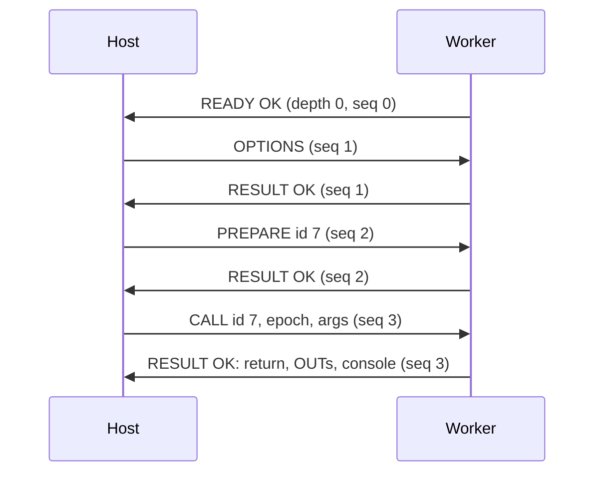
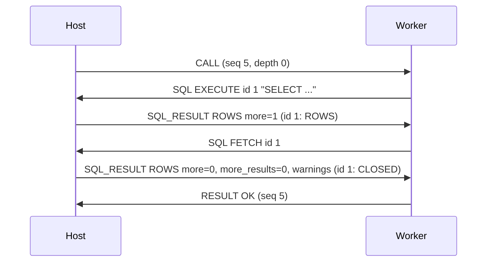
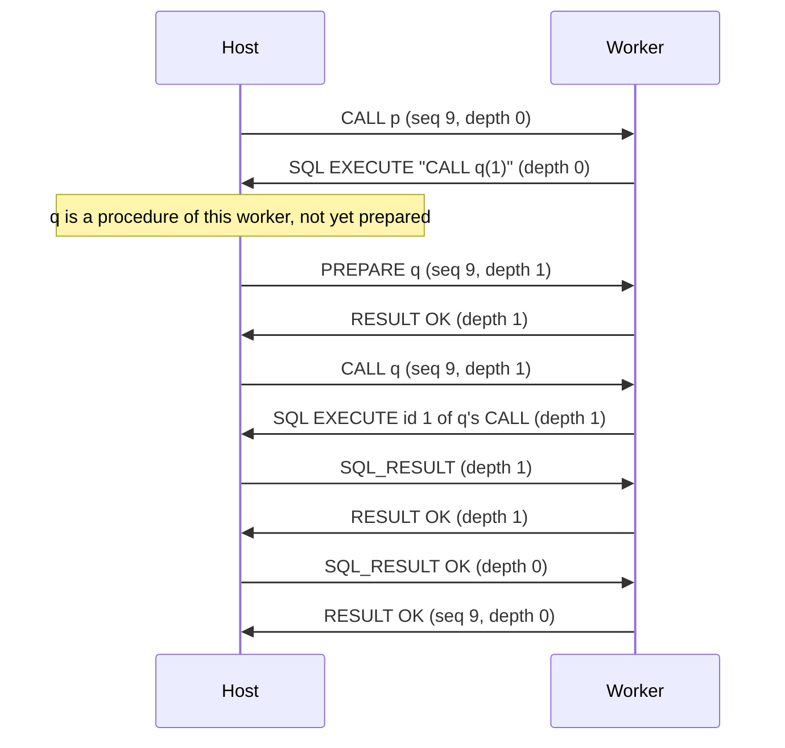
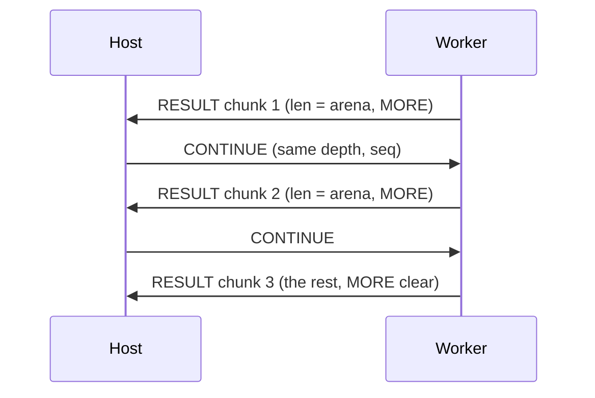
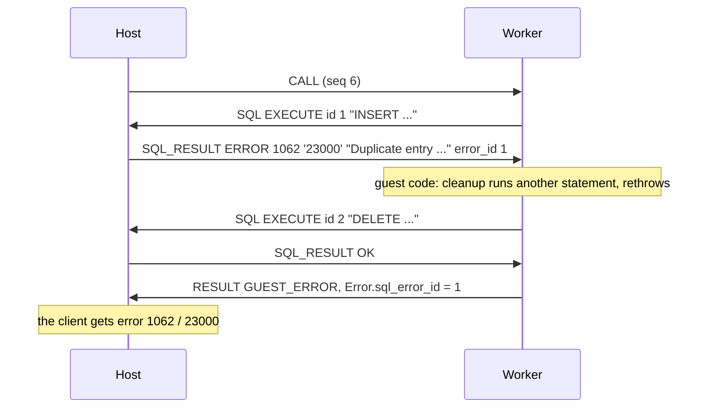

# MLE worker protocol — specification 1.0

This document is the definition of the protocol between the MLE host in
mysqld and an MLE worker process, for MySQL and Percona Server for MySQL.
It is written to be implemented from: a
developer who has only this text can write a worker or a host.

Version 1.0 is the first specified version. It was derived from the
experimental implementation (internal wire versions 1 to 3) and then
corrected; it differs from that code in layout and in rules. The
differences are tracked in `protocol-review.md`, next to this document.

The key words MUST, MUST NOT, SHOULD, SHOULD NOT and MAY are used as in
RFC 2119.

Contents

1. Terms, roles and trust
2. Process setup
3. The shared memory region
4. Turns and synchronization
5. Messages, chunks and CONTINUE
6. The control socket
7. Encoding
8. Dialogue
9. Operations
10. SQL from guest code
11. Interruption, deadlines, failure and retirement
12. Limits
13. Validation: violations and errors
14. Versioning and evolution
15. Conformance checklists
16. Sequence diagrams
17. Test vectors
Appendix A. Host policy and implementation values (informative)
Appendix B. Languages and worker kinds (informative)

---

## 1. Terms, roles and trust

**Host**: the MLE component in mysqld. **Worker**: one worker process.
**Launcher**: the helper process that creates workers. **Guest code**:
routine and library code a worker runs. **Region**: the shared memory of
one worker. **Request**: a message of the host that a worker answers with
RESULT. **Top-level request**: a request sent while the worker is idle.
**Nested request**: a request sent while the worker waits for the reply to
an SQL message.

| Role | Responsibility |
|---|---|
| Host | Decides what runs where; sends requests; runs the SQL that guest code asks for, on the session's thread, in the caller's transaction, with the rights of the worker's principal; enforces KILL, deadlines and this protocol; owns all session state. |
| Launcher | Creates worker processes with their region, control socket and sandbox; keeps pools of idle workers; reports exits. Its own protocol with the host is outside this document. |
| Worker | Runs guest code for one session at a time; answers requests; asks the host for SQL and libraries. |

### 1.1 The border between MySQL and a worker

The protocol is the whole border: a worker and mysqld share nothing but
the region and the control socket, and everything that crosses is a
message of this document. Each concern lies on exactly one side.

| Concern | MySQL side (host) | Worker side |
|---|---|---|
| SQL | Parses, plans and executes every statement; owns transactions, locks, privileges, the security context, character sets and collations, the diagnostics area, warnings, replication. | Sends statement text and parameter values; receives results. It never interprets SQL and has no connection to the server. |
| Stored programs as database objects | The catalog: names, schemas, definers, parameter lists, `USING` clauses, DDL, privileges to create and execute. Decides which routine a statement calls and in which worker it runs. | Knows a routine only as an id, a source text and a parameter list (PREPARE). It has no catalog and decides nothing about names or privileges. |
| Libraries | Stores them; decides who may import what; gives bodies and versions. | Caches bodies by version; resolves imports of guest code by asking the host. |
| Source code | Carries it as opaque text. Never parses, compiles or checks it. | Parses, compiles, checks and runs it. Every syntax or runtime rule of a language is the worker's. |
| SQL types | Knows each declared type and converts between the server's values and the wire's values (§7.2, §7.3), including character set conversion to UTF-8 and time zone conversion of TIMESTAMP. Applies the server's assignment rules to what a worker returns. | Converts between wire values and the language's values. Knows SQL types only as the `Type` it is given. |
| Session state | Owns it all: variables, time zone, current schema, transaction, the session's settings for languages. Passes what a worker needs (OPTIONS, PREPARE's `schema`). | Holds only what messages gave it, plus guest state (globals, caches) that it may lose at any RESET or retirement without harm to the database. |
| Errors | Turns outcomes into MySQL errors and warnings for the client (§10.8); owns error numbers and SQLSTATEs of the server. | Reports what happened (status, Error, stack frames); passes SQL errors back by id; may raise an SQL error by number and SQLSTATE. |
| Console output | Stores and shows it. | Collects what guest code prints and returns it in RESULT. |
| Resources | Limits what a worker makes mysqld hold (§10.7); sets the worker's limits through the launcher (memory, processes, files); enforces time (KILL, deadlines, grace). | Lives within its sandbox; reports exhaustion (EXHAUSTED, `TAINTED`); never needs anything from the operating system that the sandbox denies. |
| Isolation between users | Chooses which principal's code a worker runs and never gives a worker to another principal (§1, Principal). | Makes no decision about principals. |
| Life cycle | Starts, reuses, resets and ends workers. | Serves until told or killed; never decides to stay. |

Consequences:

* A worker needs no knowledge of MySQL beyond this document: SQL text is
  opaque to it, and a server error is a number, a SQLSTATE and a message.
* mysqld needs no knowledge of a language: a language is an identifier,
  source text is opaque, and settings are names and values (§9.8).
  Adding a language or a worker kind changes no rule of this document.
* Nothing durable lives in a worker. Killing any worker at any moment
  loses at most the request in progress and guest caches; the database's
  consistency is the server's transaction, which the host owns.
* The host does for a worker only what a message asks, in the session the
  worker serves and with the rights of the worker's principal (§1): a
  worker cannot name a session, a user or a privilege.

**Trust.** The host and the launcher are trusted. A worker is
**untrusted**: guest code may take over the worker process. Two kinds of
wrong input therefore exist and are kept apart throughout (§13):

* A **violation** is something only a worker's own code can cause: a
  malformed header, an op out of place, a broken encoding. The host MUST
  end the worker (§11.6) and fail the request in progress. The host MUST
  NOT try to resynchronize.
* An **error** is something guest code can cause through a conforming
  worker: a failing statement, a value that does not fit, a limit
  exceeded. It is reported in a reply (SQL_RESULT ERROR, RESULT with an
  Error) and the worker lives on.

Rule: **nothing that guest code can reach through a conforming worker is a
violation.** A worker MUST check what guest code gives it so that guest
code cannot make it break this protocol.

The host MUST obey these rules towards the region:

* It treats every byte of the region as hostile at all times, including
  bytes it wrote itself: the worker can write the whole region.
* It keeps all protocol state (its post count, the last value it saw of
  the worker's word, depths, sequence numbers, sizes) in private memory
  and never reads it back from the region.
* It copies a message header out of the region once, before it checks it,
  and copies a chunk's bytes before it decodes them. It never reads the
  same bytes of the region twice for one decision.
* It never reads back anything it wrote into the region.

A worker trusts the host, and the host owes it correct messages: every
value within its domain (§7.2), every str well-formed, every rule of this
document that binds the host. A worker therefore need not validate the
host as the host validates a worker. It MUST check only what keeps a
*mistaken* host from making it unsafe:

1. every length and count against the bytes it has, and every count whose
   elements can be empty against the limits of §12 (a first batch of a
   result set has at least one column);
2. every tag, kind, status, mode, action and operation it reads; it
   decodes each value by the value's own tag and need not compare that
   tag with its Column's or Param's type (a host that sends another tag
   gives guest code a value of that tag's type, nothing worse);
3. every number it uses to find its own state: the argument count of a
   CALL against the routine's Params, a routine id against what is
   prepared, the values of a row against the set's column count,
   `failed_row` against the rows it sent, UNCHANGED against a body it
   holds;
4. that the message is one its state can take: the operation, `depth`,
   `call_seq`, the reply kind for the action (§10.1), and that the
   language of a PREPARE or PARSE_LIBRARY is one it announced in READY.

It need not check that options are in force (§9.8), nor the value of a
setting it does not use.

It need not check the domains of §7.2, the well-formedness of the host's
str, reserved or unused fields, or what the host guarantees about order
and uniqueness. A host value outside its domain may give guest code an
unspecified value or end the worker, but never an access outside the
message. A worker never ignores a message: every post of the host is
followed by a post of the worker or by its exit.

When a worker finds that a message breaks this protocol (a **protocol
failure**), it MUST exit with a non-zero status, at once, without running
further guest code and without letting guest code observe the failure.
The exceptions, where a worker goes on, are named where they apply:
ill-formed text in SQL data (§7.1), any float bit pattern (§7.2), unknown
control datagrams (§6), and a host message too large for the worker to
hold (§5.3).

**Principal.** A worker has one **security principal** for its whole
life: a pair (the account that owns the code, the account whose rights
the code runs with). For a routine that runs with its definer's rights
both are the definer; for one that runs with the invoker's rights the
pair is (definer, invoker); for code a session submits directly, and for
PARSE_LIBRARY, both are the session's account; for code that a routine's
SQL submits (a routine it creates included), the pair is that routine's.
When a session creates a routine, the code is checked in the worker of
(definer, creating account): the creator wrote the code, and the
routine's own rights apply only when it is called. (To name another
definer the creator needs the privilege that already lets it run code as
that definer; its code then runs in a worker that also serves that
definer's invoker-rights routines for it. That is accepted.) "The account
whose rights apply" is always the one whose privileges the server's
security context holds at the call — under a definer-rights procedure,
view or trigger that is their definer, not the session's user. The host
never substitutes rights: it only refuses a worker whose principal
differs. An account here is one
incarnation of it: the host retires every worker whose principal names an
account that was dropped or renamed (away from that name). An account
created under a name, or renamed to it, needs no retirement: the server
already gives it the routines defined under that name, and every worker
of an earlier account of that name was retired when that account was
dropped or renamed. The host MUST NOT send a worker a PREPARE, CALL or
PARSE_LIBRARY of another principal, nor a library body that its
principal's routine may not have (§9.10), and runs a worker's SQL only
with the rights of its principal's second account. So code that took over
a worker can do only what its owner's code may already do with those
rights. RESET does not change the principal. A host MAY treat a set of
owner accounts that an administrator declared to trust each other as one
owner (Appendix A); the principal is never on the wire.

The rule protects against the code's owner. It does not protect a
principal from its callers: a caller who takes over a worker through the
data it passes gains what the principal may do, and sees what later
sessions served by that worker pass to it. A host that must exclude this
gives a worker to sessions of one account only (Appendix A).

A statement that calls a routine of another principal reaches that
routine in another worker, where it is a top-level request: `depth` and
"top-level" are per worker. A chain of calls can thus pass through
several workers of one session; where a rule speaks of "the session" it
means all of them.

**Ownership.** The launcher creates the region and the control socket and
hands the host its ends (§2). From then on the host owns the worker: it
alone decides when the worker is reused, reset or ended. A region belongs
to one worker process for that process's life and is never reused.

**Threads.** On each side exactly one thread at a time uses the mailbox:
the session's thread in mysqld, and in the worker the thread that runs
guest code. The worker reads the control socket on another thread (§6);
the host may write to it from any thread.

## 2. Process setup

1. The launcher creates a memory file (memfd) of
   `region_size = 4096 + arena_size` bytes, all zero, writes line 0 of the
   header (§3), and seals the file against shrinking, growing and further
   sealing (`F_SEAL_SHRINK | F_SEAL_GROW | F_SEAL_SEAL`), so that no
   access of the host to the mapping can fault. It creates an `AF_UNIX`,
   `SOCK_SEQPACKET` socket pair, and after the hand-over keeps no copy of
   either end (else end of file would not reach the worker).
2. The worker starts with:
   * fd 3: the memory file (the "mailbox");
   * fd 4: its end of the control socket;
   * fd 0, 1, 2: `/dev/null`, or inherited for debugging.
   No other descriptors are inherited.
3. The worker maps the first 4096 bytes of fd 3 and reads `magic`,
   `version`, `region_size` and `arena_size`.
   * If `magic` is wrong, or `region_size` is not `4096 + arena_size` or
     not the file's size, it MUST exit with status 2 without touching the
     region. (Other failures to start exit with any other non-zero
     status.)
   * Otherwise it maps `region_size` bytes shared and writable.
   * If the major part of `version` is not one it implements, it MUST post
     a failed READY (§9.1, §14) and exit.
4. The worker starts the thread that reads the control socket (§6).
5. The worker initializes its runtime and posts READY (§9.1): with status
   OK if it can serve; else with status INTERNAL and the reason, after
   which it MUST exit. READY is the only message a worker posts without a
   request.
6. The launcher hands the host the memory file, the host's end of the
   control socket and a process handle (pidfd) of the worker. The host
   MUST verify that the file has exactly the configured size and all
   three seals, and map it. It then waits for READY (§9.1). A worker taken from
   the launcher's pool may have posted READY long before.

**Initial state.** The region is zero-filled except line 0: both sequence
words are 0, both sleep flags are 0. Each side's record of the other's
word ("seen") starts at 0 — not at the word's current value: a pooled
worker has already posted READY when the host maps the region.

## 3. The shared memory region

All integers are little-endian. The region is `4096 + arena_size` bytes: a
4096-byte header, then the arena.

| Offset | Size | Field | Written by | Meaning |
|---:|---:|---|---|---|
| 0 | 4 | `magic` | launcher, once | `0x31454C4D` (the bytes `4D 4C 45 31`, "MLE1") |
| 4 | 4 | `version` | launcher, once | `major << 16 | minor`; for this document `0x00010000` |
| 8 | 8 | `region_size` | launcher, once | `4096 + arena_size` |
| 16 | 4 | `arena_size` | launcher, once | bytes of the arena |
| 20 | 44 | reserved | — | 0 |
| 64 | 4 | `to_w` | host | sequence word, host to worker |
| 128 | 4 | `to_h` | worker | sequence word, worker to host |
| 192 | 4 | `w_sleep` | worker | 1 while the worker sleeps or is about to sleep |
| 256 | 4 | `h_sleep` | host | 1 while the host sleeps or is about to sleep |
| 320 | 40 | `msg` | the side whose turn it is (§4) | header of the message in the arena (§5) |
| 384 | 32 | `stats` | worker, at any time | worker statistics (§3.1) |
| 448 | 3648 | reserved | — | 0 |
| 4096 | `arena_size` | arena | the side whose turn it is | message bytes |

Every field from offset 64 on starts a 64-byte cache line of its own, so
no two fields that different sides write share a line. Bytes not listed
are reserved: the launcher leaves them 0 and nobody checks them.

`arena_size` MUST be a multiple of 4096, at least 65536 (64 KiB) and at
most 2^30 (1 GiB). The
host uses the arena size it configured, never the value in the region.
Line 0 exists for the worker; the host does not read it.

### 3.1 Worker statistics

| Offset in `stats` | Size | Field |
|---:|---:|---|
| 0 | 8 | `heap_used`: bytes of the runtime's heap in use |
| 8 | 8 | `heap_max`: the heap's limit |
| 16 | 8 | `gc_count`: collections the worker forced since the last RESET |
| 24 | 4 | `state`: 0 starting, 1 ready, 2 running, 3 compiling |
| 28 | 4 | reserved |

The worker writes the statistics whenever it likes, without
synchronization. They are for reporting only: the host copies them in one
read, replaces impossible values (`heap_used > heap_max` when `heap_max`
is not 0, an unknown `state`) and MUST NOT base any decision on them. A
worker SHOULD NOT write them on every request: each write costs both
sides a cache line. It writes them when they have changed enough to
matter (for example after a full collection), and when it becomes ready
after start and after a RESET. `state` 2 and 3 are optional: a worker
that does not write per request shows 1 while it serves. A figure the
runtime does not have is 0 (`heap_max` 0: no known limit).

## 4. Turns and synchronization

### 4.1 The turn

The two sides strictly alternate. Let *W* be the number of posts the host
has made and *H* the number the worker has made. A side **posts** by
storing its new count, modulo 2^32, into its sequence word; it keeps the
count privately and does not read the word back (the host MUST NOT: the
worker can write it). Initially W = H = 0.

* It is the **worker's turn** when H = W and the **host's turn** when
  H = W + 1. No other state is legal.
* Only the side whose turn it is may write `msg` and the arena. It posts
  by writing the arena, then `msg`, then storing its word. The post
  passes the turn.
* The side that does not have the turn MUST NOT write `msg` or the arena.
* A side reads `msg` and the arena only between observing the other
  side's post and its own next write to the arena. What it needs later it
  MUST copy first.
* While a side composes a message, nothing else may be posted and the
  message must not be disturbed. A worker that converts guest values
  while it writes (a conversion can run guest code) meets this either by
  converting first and writing afterwards, or by refusing, with an error
  in guest code, any SQL or import that guest code attempts during the
  conversion. In both cases the body is complete before its first chunk
  is posted; views of the arena that guest code holds are copied or
  detached before the worker writes the arena; and a request is not over
  for interrupts (§11.1) before its conversions are done.

So the worker begins (READY), and every message, CONTINUE included, passes
the turn. There is never more than one message outstanding.

Each side keeps privately the value of the other side's word that it last
saw (`seen`, initially 0). A message has arrived when the word differs
from `seen`; the receiver then sets `seen` to the value it read. The words
are 32 bits and wrap around; they are compared only for equality. (The
host need not check that the worker's word grew by exactly 1: a worker
that posts wrongly fails the checks on what it posted.)

Per side, the mailbox is in one of these states:

| State | Meaning | Leaves by |
|---|---|---|
| WAIT | the other side has the turn | observing a post → HOLD |
| HOLD | this side has the turn; it reads the message, then composes its own | posting → WAIT |

The worker starts in HOLD (with nothing to read: it composes READY), the
host in WAIT.

Receiving and sending a message in chunks (§5.2) are sequences of these
two states, restricted to chunks and CONTINUE.

A worker that posts out of turn harms only itself: the host then reads a
header that is not the reply it expects and ends the worker.

### 4.2 Memory ordering

* The poster's writes to the arena and to `msg` precede its store to the
  word. That store, and the poster's load of the other side's sleep flag
  that follows it (§4.3), MUST be sequentially consistent.
* The receiver's load of the word that discovers a post MUST have at least
  acquire ordering, and precede its reads of `msg` and the arena.
* In the sleep handshake (§4.3), the store to the sleep flag (step 1) and
  the load of the word that follows it (step 2) MUST be sequentially
  consistent. Steps 3 and 4 need no more than a plain store and an
  acquire load.

### 4.3 Waiting

A receiver MAY poll the other side's word for a while (with a CPU pause
hint) before it sleeps. To sleep it MUST:

1. store 1 into its own sleep flag (`w_sleep` or `h_sleep`);
2. load the other side's word; if it equals `seen`, call `FUTEX_WAIT` on
   that word with expected value `seen`;
3. store 0 into its sleep flag;
4. load the word; if it differs from `seen`, a message arrived; else go to
   step 1.

A poster, after its store, MUST load the other side's sleep flag and, if
it is non-zero, call `FUTEX_WAKE` for one waiter on its word.

*No wake-up is lost.* The four operations (the sleeper's flag store and
word load of steps 1 and 2; the poster's word store and flag load) are
sequentially consistent, so they have one order. If the poster's flag
load finds the flag set, the poster wakes; a sleeper that has not reached
the kernel yet finds the word changed in `FUTEX_WAIT` and returns at
once. If it finds the flag clear, the sleeper's next step 1 comes after
that load, hence after the poster's store: either step 4 of the current
pass already saw the new word, or step 2 of the next pass does.

The words are shared between processes: futex calls MUST NOT use
`FUTEX_PRIVATE_FLAG`.

The host's sleeps MUST be bounded (it must notice kills, §11.1,
deadlines, §11.2, and the worker's death, §11.4). The host MUST NOT depend on being woken: a
hostile worker may never wake it. The worker's sleeps MAY be unbounded: it
learns that the host is gone from the control socket (§6).

## 5. Messages, chunks and CONTINUE

### 5.1 The message header

| Offset in `msg` | Size | Field | Meaning |
|---:|---:|---|---|
| 0 | 4 | `op` | operation, §9 |
| 4 | 4 | `status` | RESULT: §9.4; READY: §9.1. Every other message: 0 |
| 8 | 4 | `flags` | bit 0 `MORE`: more chunks of this message follow. Bit 1 `TAINTED`: only in a RESULT: the worker asks to be retired (§11.5). Other bits: 0 |
| 12 | 4 | `depth` | nesting depth of the request this message belongs to (§8.2) |
| 16 | 4 | `len` | bytes of this chunk in the arena |
| 20 | 4 | reserved | 0 |
| 24 | 8 | `total_len` | bytes of the whole message body |
| 32 | 8 | `call_seq` | sequence number of the top-level request (§8.2) |

A message is a header and a body of `total_len` bytes. The body's layout
depends on `op` (§9). The host MUST consume a worker's body exactly:
missing or trailing bytes are malformed. A worker never reads past a
body and need not look for trailing bytes (§1).

### 5.2 Chunks

* If `total_len <= arena_size`, the message is one chunk:
  `len = total_len`, `MORE` clear.
* Otherwise the sender splits the body in order: every chunk but the last
  has `len = arena_size` and `MORE` set; the last has `MORE` clear and
  carries the rest (1 to `arena_size` bytes). All chunks carry the same
  `op`, `status`, `depth`, `call_seq`, `total_len` and `TAINTED` flag.
* After each chunk with `MORE`, the receiver copies it and posts
  **CONTINUE** (op 10): `status` 0, `flags` 0, `len` 0, `total_len` 0, and
  the `depth` and `call_seq` of the message being received. The sender
  then posts the next chunk.
* From the first chunk to the last, the receiver posts only CONTINUE and
  the sender only chunks of that message. A transfer cannot be abandoned:
  an interrupt (§11.1) takes effect after it.

The receiver of a chunked message MUST check, **on the first chunk**,
everything it would check on a whole message (op allowed here, `depth`,
`call_seq`, `total_len` within the limit for this op, §12), and on every
chunk the rules above, including that `op`, `status`, `depth`, `call_seq`
and `total_len` repeat the first chunk's; as sender it MUST check every
CONTINUE in full (all header fields as given above). These are the host's
duties. A worker checks of each chunk its `len` (at most the arena and the
bytes still due) and, on the first, what §1 lists and whether it can hold
`total_len` (§5.3); of a CONTINUE, its `op`.

### 5.3 Size limits

* A worker's message is at most **64 MiB**; some worker messages are
  limited to one chunk of at most 64 KiB (§12). A worker MUST NOT exceed
  these: it is a violation. What guest code produces beyond the limit the
  worker MUST turn into an error itself (§9.4, §10.6).
* A host's message is at most **1 GiB**; OPTIONS, DROP and RESET are one
  chunk of at most 64 KiB. The host decides before it posts the first
  chunk; what would be larger fails instead: a request fails the statement
  that needed it (the user's, or for a nested request the SQL statement,
  with ERROR), an SQL_RESULT becomes ERROR, a LIBRARY_RESULT becomes
  REFUSED.
* A worker that cannot hold a host message (its memory is smaller) MUST
  still complete the transfer, discarding the chunks, and then fail it
  where it belongs. A PREPARE, CALL or PARSE_LIBRARY: RESULT EXHAUSTED
  (without `TAINTED`: the worker is sound); of a PREPARE it keeps the
  `routine_id` from the first chunk, for that id is then not prepared
  (§8.3). An SQL_RESULT: the worker
  sends CLOSE for that id (it cannot know the id's state) and raises an
  error in guest code. A LIBRARY_RESULT: as for REFUSED (§9.10): the
  import fails; no answer is held, and a held one is unchanged. It MUST
  NOT exit. OPTIONS, DROP and RESET are at most 64 KiB; a worker that
  cannot hold even these answers INTERNAL with `TAINTED`.
* An SQL message whose `total_len` would put the host over its bound on
  request bytes (§10.7) is treated alike: the host completes the transfer
  and keeps
  only `action` and `statement_id` from the first chunk (a body shorter
  than these 9 bytes is malformed; an unknown action is a violation); the
  rest of the body is neither kept nor checked. The reply is ERROR and
  the id's next state follows §10.1, by rule 2 or 3 as it applies. CLOSE
  is never refused this way: its body is always 26 bytes, and another
  length is a violation. No other message of a worker is discarded, and
  the other bounds of §10.7 are applied after a message was decoded and
  checked in full.
* String fields have no limits of their own beyond these and §12.

## 6. The control socket

A `SOCK_SEQPACKET` pair; each datagram is one message. Only the host
sends; it never reads.

| Message | Bytes | Meaning |
|---|---|---|
| INTERRUPT | `01`, then u64 `call_seq` (little-endian): 9 bytes | stop top-level request `call_seq` (§11.1) |

* The worker reads the socket on a thread of its own, for its whole life.
* End of file (the host closed its end, or mysqld died) MUST make the
  worker exit promptly. This is how a worker is told to stop. The host
  never sends an empty datagram: a read of 0 bytes is end of file.
* The worker MUST ignore a datagram with an unknown first byte or with a
  length other than given above (it reads with a buffer larger than 9
  bytes to know the length).
* The host MUST send without blocking and without raising a signal when
  the worker closed its end. A send that fails is not repeated: a worker
  that does not take its INTERRUPT is ended when the grace period is over
  (§11.1).
* The host MAY send several INTERRUPTs for one request, from any thread.

## 7. Encoding

### 7.1 Primitives

| Name | Encoding |
|---|---|
| u8, u16, u32, u64 | unsigned, little-endian, fixed width |
| i64 | two's complement, little-endian |
| f32, f64 | IEEE 754 binary32 / binary64, little-endian |
| bool | u8 0 or 1; any other value is malformed |
| str | u32 byte length, then the bytes: well-formed UTF-8 |
| lstr | as str, but the host may send bytes that are not well-formed UTF-8 (below); from a worker it MUST be well-formed |
| bytes | u32 byte length, then any bytes |
| list of X | u32 count, then that many X |

*Well-formed UTF-8*: no overlong forms, no surrogates (U+D800..U+DFFF),
nothing above U+10FFFF. U+0000 is allowed.

A receiver MUST check a count against the bytes left in the body (every
element has a minimum size) before it allocates for it; the host also
checks it against the limits of §12 (a worker: §1, item 1).

**Text from a worker.** Every str and lstr a worker sends MUST be
well-formed; the host checks it and anything else is a violation. Text that guest code
produces and that is not well-formed (unpaired surrogates in languages
whose strings are UTF-16 or code points, bytes from a native library) MUST
be repaired by the worker.

*Repair* means: decode as UTF-8 and replace each maximal subpart of an
ill-formed sequence by U+FFFD, as the Unicode Standard recommends
(Unicode Standard, section 3.9; the WHATWG "UTF-8 decode" algorithm does
this: `F0 80 80` gives three U+FFFD). Unpaired surrogates of a UTF-16 or code-point string each become
one U+FFFD.

Repair is for data and messages: values and error messages. Where the text is *code or a name* — the `text` of an SQL
message, a library's schema or name — a worker MUST NOT repair it: it
raises an error in guest code, for a repaired statement would be another
statement.

**Text from the host.** Every str the host sends is well-formed: it
repairs what it takes from the server (error and warning messages can
quote column bytes). Source code (`source`, a library `body`) that is not
well-formed is not sent: the user's statement fails, and a LIBRARY for
such a body is answered REFUSED. STRING and JSON
*values* (§7.2) are of type lstr:
they carry the server's data unrepaired, and a server can hold ill-formed
text. A worker MUST accept ill-formed UTF-8 in them, repairing the value
when it converts it to a language string; it MUST NOT exit or fail the
request for it. (So ill-formed text that a routine reads and writes back
is changed.)

**Character sets.** The wire knows only UTF-8. The host converts every
character value from its column's or variable's character set to utf8mb4
before it sends it, and treats every STRING and JSON it receives as
utf8mb4, converting to the target's character set. `Column.charset` and
`collation` are information for guest code.

### 7.2 Values

A value is a u8 tag and a payload.

| Tag | Name | Payload | Domain |
|---:|---|---|---|
| 0 | NULL | none | SQL NULL |
| 1 | I64 | i64 | any |
| 2 | U64 | u64 | any |
| 3 | F64 | f64 | finite (see below) |
| 4 | F32 | f32 | as F64 |
| 5 | DECIMAL | str | `-?[0-9]+(\.[0-9]+)?`, 1 to 100 bytes |
| 6 | STRING | lstr | UTF-8 (§7.1) |
| 7 | BYTES | bytes | any |
| 8 | DATE | Civil | year ≤ 9999, month ≤ 12, day ≤ 31; hour = minute = second = microsecond = 0; negative = 0 |
| 9 | TIME | Civil | year = month = day = 0; hour ≤ 838, minute ≤ 59, second ≤ 59, microsecond ≤ 999999; not beyond 838:59:59.000000; negative 0 or 1 |
| 10 | DATETIME | Civil | year ≤ 9999, month ≤ 12, day ≤ 31; hour ≤ 23, minute ≤ 59, second ≤ 59, microsecond ≤ 999999; negative = 0 |
| 11 | TIMESTAMP | i64 | microseconds since 1970-01-01 00:00:00 UTC, 0 to 253402300799999999; or −2^63 for MySQL's zero timestamp |
| 12 | JSON | lstr | JSON text in UTF-8; its syntax is not checked on the wire (text that is not JSON is an error where the server stores it) |
| 13 | VECTOR | u32 `dims`, padding, `dims` × f32 | 1 ≤ `dims` ≤ 16383; elements as F32 |

An unknown tag is malformed.

**Civil** (15 bytes): u16 year, u8 month, u8 day, u32 hour, u8 minute,
u8 second, u32 microsecond, bool negative. A Civil value is a calendar
date and clock time without a time zone. Month 0 and day 0 are legal
(MySQL's zero and partial dates); days are not checked against the month.
A TIME with all fields zero and negative = 1 is legal and equals zero;
senders SHOULD send negative = 0 for it.

**TIMESTAMP** is an instant. The host converts between the instant and the session's zone when it talks to
the server; a worker converts to its language's instant type, or to local
time in the zone of OPTIONS (§9.8) where a language requires that. The
host takes the instant from the server's stored value where the server
gives it; where the server gives only a local time, the host converts it
with the session's current zone, and a local time in an hour that the
zone repeats is taken as its first occurrence, one that the zone skips as
the server takes it (Appendix A); in the other direction an instant in a
repeated hour reaches the server as a local time and is stored as its
first occurrence. Both
directions use the server's own rules for zones and for a repeated local
time. If the host cannot convert in the session's current zone, a result
fails with SQL_RESULT ERROR, an argument fails the statement before CALL
is sent, and a returned value fails as a conversion error. Wire value 0
is 1970-01-01 00:00:00 UTC.

A worker sends a language value that is an instant as TIMESTAMP and one
without a zone as DATETIME. DATETIME has no zone on the wire: a worker
that maps it to an instant type uses the zone of OPTIONS, which is the
session's zone only as long as the session has not changed it since its
options were fixed (Appendix A); after such a change, DATETIME values the
server computes in the new zone are read in the old one. The
wire's range is wider than what a TIMESTAMP column stores; a value the
server does not accept is an error (§9.4, §10.4).

**DECIMAL.** No `+`, no exponent, no leading or trailing `.`; leading
zeros and `-0` are legal. The host sends the server's canonical form.

**Floats.** −0.0 is preserved in both directions. NaN and the infinities
are not SQL values. The host never sends them, but a worker accepts any
bit pattern and MUST NOT exit for one. For floats from a worker (F64, F32,
VECTOR elements) **the host is the checker**: it MUST check every one, and
a non-finite float is an *error*: an SQL parameter gives SQL_RESULT ERROR,
a result value fails the request as a conversion error (§9.4). This is a
deliberate exception to the rule that domains are violations (§13): it
spares a worker from scanning every vector a second time. A worker SHOULD
still refuse a non-finite scalar itself, for a better message in the
language (Appendix B.5).

**VECTOR.** After `dims`, zero bytes pad the position to a multiple of 16
counted from the start of the message body (0 to 15 bytes; they MUST be
zero), then the elements follow. So the encoding of a VECTOR depends on
where it stands in the body: it cannot be copied between messages byte for
byte. The arena starts at a multiple of 4096 and every chunk but the last
is a whole arena, so the elements of a one-chunk message are 16-byte
aligned in the arena; a receiver that reassembles a chunked message and
reads elements in place MUST put the body at a 16-byte aligned address.
Elements never straddle a chunk boundary (`arena_size` is a multiple of
16), but a VECTOR may. (The padding lets a worker read the elements in
place as an array of floats. Such a view of the arena is valid only until
the worker's next write to the arena, §4.1: guest code that keeps a
vector gets a copy.)

### 7.3 SQL types and tags (normative)

| SQL type | Tag |
|---|---|
| TINYINT, SMALLINT, MEDIUMINT, INT (signed or unsigned), YEAR, BOOL | I64 |
| BIGINT | I64 |
| BIGINT UNSIGNED, BIT | U64 |
| FLOAT | F32 |
| DOUBLE | F64 |
| DECIMAL | DECIMAL |
| DATE | DATE |
| TIME | TIME |
| DATETIME | DATETIME |
| TIMESTAMP | TIMESTAMP |
| JSON | JSON |
| VECTOR | VECTOR |
| CHAR, VARCHAR, TEXT types, ENUM, SET | STRING |
| BINARY, VARBINARY, BLOB types, GEOMETRY | BYTES |

* **From the host**, a value whose declared type is known (an argument, a
  row value under its Column) is NULL or has exactly the tag of this table.
  A worker MAY rely on it; it need not check it (§1, item 2), and if it
  does, another tag is a protocol failure. A column
  without a type (`SELECT NULL`) has `Type.tag` 0 and only NULL values.
* **From a worker**, a value (a return value, an OUT parameter, an SQL
  parameter) may have any tag: the host converts it to the target type
  with the server's assignment rules, and a failed conversion is an error
  (§9.4, §10.4). A worker SHOULD send the tag of the declared type.

### 7.4 Structures

```
Type    = u8 tag, bool unsigned, u32 length, u32 precision, u32 scale,
          str type_name
Param   = str name, u8 mode (0 IN, 1 OUT, 2 INOUT), Type
Column  = str name, str table, Type, str org_name, str schema,
          str org_table, str charset, str collation, u32 flags
Frame   = str function, str file, u32 line, u32 column, u32 end_column,
          str text
Error   = str language, str message, list of Frame, u32 sql_errno,
          str sqlstate, u64 sql_error_id
Warning = u32 level, u32 code, str message
```

* `Type.tag`: the tag of the declared type (§7.3): 1 to 13, or 0 for a
  column without a type (its `type_name` is `NULL`). `unsigned`: the type is
  unsigned. `length`: character length (STRING), byte length (BYTES), bits
  (BIT), dimensions (VECTOR), else 0. `precision` and `scale`: as declared
  for DECIMAL; `scale` also the fractional-second digits of TIME, DATETIME
  and TIMESTAMP; else 0. `type_name`: the SQL type in upper case without
  length or attributes (`INT`, `VARCHAR`, `VARBINARY`, `TEXT`, `SET`,
  `YEAR`, `BIT`, ...); never empty.
* `Column`: `name` is the label, `table` the table's alias, `org_name` and
  `org_table` the underlying names, `flags` MySQL's field flags.
* `Frame`: `line`, `column`, `end_column` are 1-based, 0 means unknown;
  `text` is the frame's source line, trimmed, possibly empty. An Error has
  at most 1000 frames; a worker cuts a longer trace.
* `Error.language`: one of the worker's READY languages when guest code
  failed in that language; `""` for an error of the worker itself, or of
  guest code in a language outside that list; or, only with status
  GUEST_ERROR, a marker: `MLE-Type` (a value did not convert; only in the
  RESULT of a PREPARE or CALL), `MLE-TimeZone` and `MLE-Option` (OPTIONS named a zone
  the worker does not know, or gave a setting a value it does not accept;
  only in the RESULT of OPTIONS). Anything else is a violation. Where the
  host's reaction depends on the kind of error, it MUST decide by
  `language`, never by the message's text.
* Lengths, kept by the worker by cutting at a character boundary:
  `message` at most 16 KiB; `function` and `file` at most 1 KiB each;
  `text` at most 1 KiB.
* `Error.sql_errno`, `sqlstate`, `sql_error_id`: §10.8. `sqlstate` is
  empty or 5 characters of `[0-9A-Z]`; `sql_errno` is 0 to 65535.
* `Warning.level`: 0 note, 1 warning, 2 error.

## 8. Dialogue

### 8.1 Grammar

`h:` the host posts, `w:` the worker posts. Chunks and CONTINUE are below
this level (§5.2).

```
Worker     = w:READY(OK)  Top*
           | w:READY(INTERNAL)

Top        = h:PREPARE(0,s)        InPrep(0,s)*   w:RESULT(0,s)
           | h:CALL(0,s)           InCall(0,s)*   w:RESULT(0,s)
           | h:PARSE_LIBRARY(0,s)                 w:RESULT(0,s)
           | h:DROP(0,s)                          w:RESULT(0,s)
           | h:RESET(0,s)                         w:RESULT(0,s)
           | h:OPTIONS(0,s)                       w:RESULT(0,s)

Nested(d,s) = h:PREPARE(d,s)       InPrep(d,s)*   w:RESULT(d,s)
            | h:CALL(d,s)          InCall(d,s)*   w:RESULT(d,s)
            | h:DROP(d,s)                         w:RESULT(d,s)

InCall(d,s) = w:SQL(d,s)      Nested(d+1,s)*  h:SQL_RESULT(d,s)
            | w:LIBRARY(d,s)                  h:LIBRARY_RESULT(d,s)

InPrep(d,s) = w:SQL(d,s)                      h:SQL_RESULT(d,s)
            | w:LIBRARY(d,s)                  h:LIBRARY_RESULT(d,s)
```

`(d,s)` are the header's `depth` and `call_seq`.

* While it serves PREPARE a worker may send SQL, but the host answers
  ERROR (§10.4; CLOSE: OK, §10.1) and sends no nested request: loading a routine
  cannot run SQL. It is in the grammar so that guest code that tries gets
  an error, not a dead worker.
* The host MUST treat any message of a worker that the grammar does not
  allow at that point as a violation.
* A worker that receives a message its state cannot take exits (§1,
  item 4).

### 8.2 Depth and call sequence

* `call_seq` is a u64 the host assigns to each top-level request: 1 for
  the first request to a worker and exactly 1 more for each later one, over
  the worker's whole life (also when another session takes the worker).
  A `call_seq` is used up at the moment the first chunk of its request is
  posted, and not before: a request the host decides not to send uses
  none.
  READY has `call_seq` 0. Every message of a top-level request, at every
  depth, carries its `call_seq`.
* `depth` is 0 for a top-level request and for every message exchanged
  while the worker serves it at that level. A nested request sent while
  the worker waits for the SQL_RESULT of an SQL message of depth d has
  depth d + 1, and so have the messages exchanged while the worker serves
  it. SQL_RESULT and LIBRARY_RESULT carry the depth of the message they
  answer.
* The host MUST check `depth` and `call_seq` of every message of a worker.
* `depth` is at most 31. The host does not send a nested request at depth
  32: it fails the SQL statement that needs it with an error ("too many
  nested routine calls").

### 8.3 Routines

A routine id (u64) is chosen by the host, unique within mysqld. In a
worker an id is **prepared** from a PREPARE that answered OK until DROP,
RESET, or a later PREPARE of the same id.

* PREPARE of a prepared id replaces it. A PREPARE that does not answer OK
  leaves the id **not prepared** on both sides, whatever it was before;
  so does a DROP that answers INTERNAL.
* The host sends CALL only for ids that are prepared in that worker, and
  checks the RESULT of a CALL against the Params that were in force when
  it sent the CALL (a nested PREPARE may replace them meanwhile).
* A routine may be running (an **activation**) when a nested PREPARE or
  DROP names its id. A running activation always continues with the code
  it started with; PREPARE, DROP and the relinking of §9.10 affect later
  CALLs only. A worker MUST
  keep a running activation's code alive until it returns.

## 9. Operations

| Op | Name | Direction | Reply |
|---:|---|---|---|
| 1 | READY | w → h | — |
| 2 | PREPARE | h → w | RESULT |
| 3 | CALL | h → w | RESULT |
| 4 | RESULT | w → h | — |
| 5 | SQL | w → h | SQL_RESULT |
| 6 | SQL_RESULT | h → w | — |
| 8 | DROP | h → w | RESULT |
| 9 | RESET | h → w | RESULT |
| 10 | CONTINUE | both | — (§5.2) |
| 11 | OPTIONS | h → w | RESULT |
| 12 | PARSE_LIBRARY | h → w | RESULT |
| 13 | LIBRARY | w → h | LIBRARY_RESULT |
| 14 | LIBRARY_RESULT | h → w | — |

Ops 0, 7 and above 14 are not assigned.

Requests at a glance (status names: §9.4; deadlines and interruption:
§11):

| Request | Depth | Inner messages | RESULT statuses | Return value | OUT params | Console | Findings | RESULT size |
|---|---|---|---|---|---|---|---|---|
| PREPARE | any | SQL (refused), LIBRARY | OK, GUEST_ERROR, INTERRUPTED, EXHAUSTED, INTERNAL | no | no | yes | if `check` | 64 MiB |
| CALL | any | SQL, LIBRARY | OK, GUEST_ERROR, INTERRUPTED, EXHAUSTED, INTERNAL | iff function and OK | iff OK | yes | no | 64 MiB |
| PARSE_LIBRARY | 0 | none | OK, GUEST_ERROR, INTERRUPTED, EXHAUSTED, INTERNAL | no | no | no | no | 64 MiB |
| DROP | any | none | OK, INTERNAL | no | no | no | no | one chunk, 64 KiB |
| RESET | 0 | none | OK, INTERNAL | no | no | no | no | one chunk, 64 KiB |
| OPTIONS | 0 | none | OK, GUEST_ERROR (`MLE-TimeZone`, `MLE-Option` only), INTERNAL | no | no | no | no | one chunk, 64 KiB |

"if `check`": empty unless PREPARE's `check` is 1 and the status is OK;
otherwise a violation.
A status not listed for a request is a violation. "no" in a column means
the field MUST be absent or empty; otherwise a violation.

### 9.1 READY (1)

```
u32 version, str info, u64 features, str worker_class,
list of str languages (≤ 16), str runtime
```

Posted once after start (§2), `depth` 0, `call_seq` 0, one chunk of at
most 64 KiB.

* `version`: the protocol version the worker speaks, encoded as in the
  region: the region's major with the worker's highest minor of it; or,
  if the worker does not implement that major, its highest version. A
  host ignores a minor above its own (§14).
* `features`: bits for optional capabilities. Version 1.0 defines none:
  the worker sends 0. Minor versions assign bits; a host ignores bits it
  does not know.
* `info`: free text; with a failed READY, the reason.
* `worker_class`: the kind of worker, fixed by its implementation (not a
  name from the host's configuration), 1 to 32 characters of `[a-z0-9_]`
  (Appendix B.1).
* `languages`: the language identifiers the worker accepts in PREPARE and
  PARSE_LIBRARY, at least one, each 1 to 32 characters of `[a-z0-9_]`, no
  duplicates.
  The identifiers in use are listed in Appendix B.1.
* `runtime`: free text describing the runtime and its version.

Status OK: the worker serves. Status INTERNAL: it does not; it exits
after the post, and the host ends it and reports `info` (as an
incompatible worker, below, if `version` has another major than the
host's). No other status
is legal. With INTERNAL the body MAY end after `info`, and the host
decodes and checks only `version` and `info` and ignores the rest (the
one exception to "consume exactly", needed between versions, §14).

The host MUST check `op`, `flags`, `depth`, `call_seq`, the size and the
status (violations). With status OK it first decodes `version`: if the
major is not its own, it decodes nothing further, retires the worker and
reports an **incompatible worker** (the worker is not at fault).
Otherwise it checks the body in full (a malformed `worker_class` or
`languages` is a violation) and that the language it needs is listed
(else, again, an incompatible worker).

### 9.2 PREPARE (2)

```
u64 routine_id, str language, str name, str entry, str source,
list of Param (≤ 65535), bool has_return [, Type return_type],
list of (str schema, str library, str alias) imports (≤ 65535),
str schema, bool check, u64 library_epoch
```

Compile a routine and prepare it under `routine_id` (§8.3).

* `language`: one of READY's languages (the host sends no other).
* `name`: the routine's name, for messages and stack traces.
* `entry`: empty — `source` is a routine *body*; the worker makes it a
  function whose parameters are the routine's parameters by name. `<eval>`
  — `source` is an expression or snippet to evaluate; no parameters; the
  routine returns its value as text (`return_type` is a STRING type).
  Otherwise the name of the entry point in `source` (its form is the
  language's).
* `imports`: the libraries of the routine's `USING` clause; an empty
  `alias` means the library's own name.
* `schema`: the routine's schema: the current schema while it runs. For
  `<eval>` it is the session's current schema and may be empty.
* `check`: the worker also looks for problems beyond syntax and reports
  them as findings (§9.4); they do not fail the PREPARE.
* `library_epoch`: §9.10.

The host guarantees: Param names are not empty and differ; `imports`
have non-empty names (as §9.10) and effective aliases (the alias, or the
library's name when the alias is empty) that differ; `schema` is not
empty (except for `<eval>`); with `<eval>` there are no Params and
`has_return` is 1.

RESULT: OK; GUEST_ERROR with the compile error; others per the table.
What the language cannot take as it is (parameter names that are not its
identifiers, more parameters than it allows, a source it does not
support) gives GUEST_ERROR.
PREPARE may run guest code (in languages where loading code executes
it): it is interruptible
and may print.

### 9.3 CALL (3)

```
u64 routine_id, u64 library_epoch, list of value arguments (≤ 65535)
```

Run a prepared routine. One argument per Param of its PREPARE, in order:
NULL for an OUT parameter, the current value for IN and INOUT. The host
guarantees the id is prepared and the count is right; a worker that finds
otherwise treats it as a protocol failure (§1). `library_epoch`: §9.10.

### 9.4 RESULT (4)

```
bool has_return [, value return],
list of (u32 index, value) out_params (≤ 65535),
bytes stdout, bytes stderr, bool console_cleared,
list of str findings (≤ 1000),
bool has_error [, Error]
```

`status` in the header:

| Status | Name | Meaning | Error |
|---:|---|---|---|
| 0 | OK | done | absent |
| 1 | GUEST_ERROR | guest code failed or did not compile, or a value did not convert | present |
| 2 | INTERRUPTED | stopped by INTERRUPT (§11.1) | present |
| 3 | EXHAUSTED | the runtime's heap or stack is exhausted (not a limit guest code can catch, below), or the worker cannot hold a host message (§5.3) | present |
| 4 | INTERNAL | the worker itself failed | present |

Any other status is a violation. Rules (each a violation if broken):

* `has_error` is 1 exactly when `status` is not OK.
* `has_return` is 1 exactly when the request is a CALL whose PREPARE had
  `has_return`, and `status` is OK.
* `out_params`: with a CALL of status OK, exactly one entry for every OUT
  and INOUT Param of the PREPARE, in ascending `index` (its position in
  the Param list, counted from 0); otherwise empty.
* `stdout`, `stderr`, `console_cleared`, `findings`: empty (0) where the
  table of §9 says "no".
* `Error.sqlstate` and `sql_errno` are checked with every status, though
  used only with GUEST_ERROR (§10.8).
* INTERRUPTED only if the host has requested an interrupt of this
  `call_seq` (§11.1).
* `Error.language` as §7.4; `sql_errno` at most 65535; at most 1000
  frames.

**Values.** A worker converts the routine's result to the declared type
and SHOULD send that type's tag. If guest code returns something the
worker cannot convert, the worker answers GUEST_ERROR with language
`MLE-Type`. If the host cannot store a value it received (§7.3; a
non-finite float, §7.2), the request fails as if the worker had answered
GUEST_ERROR / `MLE-Type`, and the worker lives on.

**Size.** The parts of a RESULT that guest code can make large have caps
(§7.4 for an Error; one finding at most 4 KiB, 1000 findings); the worker
cuts them. If the RESULT with these caps still exceeds 64 MiB, the worker
cuts console output, keeping the end of each stream; what it cuts is
dropped, not sent later. If the RESULT without any console output still
exceeds 64 MiB, it answers GUEST_ERROR / `MLE-Type` instead ("the result
is larger than MLE allows"). For DROP, RESET and OPTIONS the worker cuts
the Error (frames first, then the message) so that the RESULT fits its
64 KiB.

**Console.** `stdout` and `stderr` are everything (within the bound
below) that guest code printed in
this worker that no earlier RESULT carried, at whatever depth it was
printed (any bytes): so with nested requests the host receives output in
the order it was printed. The order between the two streams is not kept.
Only the RESULTs of PREPARE and CALL carry console output; output printed
at another time (by guest code that runs outside a request, §10.6) waits
for the next of them, and RESET discards what waits. A worker may bound
the output it keeps per stream (not below 64 KiB), keeping the end.
`console_cleared` = 1: guest code cleared the console before it printed
what this message carries; the host drops all output it kept for the
session.

**Findings.** One str per problem a PREPARE with `check` found; only
with status OK (with another status: a violation).

**Host reactions.** OK: the request succeeded. GUEST_ERROR, INTERRUPTED,
EXHAUSTED: the request fails with that outcome; the worker stays in use
unless it set `TAINTED` (§11.5). INTERNAL from PREPARE, CALL or
PARSE_LIBRARY: the request fails with an internal error; the worker stays
in use unless it set `TAINTED`. INTERNAL from DROP, RESET or OPTIONS: the host
retires the worker (after the top-level request, if the DROP was nested).

A worker MUST set `TAINTED` when it answers EXHAUSTED because its
runtime's heap or stack was exhausted, and when it answers INTERNAL
because its own state may be damaged.

EXHAUSTED is for exhaustion that may leave the runtime unsound. A limit
of the language that guest code can catch and that leaves the runtime
sound (Python's `RecursionError`, JavaScript's `RangeError` for the call
stack size) is an ordinary error of guest code: uncaught, the request
ends GUEST_ERROR, without `TAINTED`.

### 9.5 SQL (5), SQL_RESULT (6)

```
SQL        = u8 action, u64 statement_id, str text,
             list of value params (≤ 65535), u8 flags, u32 max_rows,
             u32 row_width

SQL_RESULT = u8 kind, then
  0 ERROR: u32 sql_errno, str sqlstate, str message, u32 failed_row,
           u64 error_id
  1 OK:    u64 affected_rows, u64 last_insert_id, list of Warning,
           bool more_results, u32 param_count, u64 exec_us
  2 ROWS:  list of Column (≤ 4096), u64 total_rows, u32 nrows,
           nrows × ncolumns values (row by row),
           bool more, bool more_results, list of Warning, u64 exec_us
  3 END:   (nothing)
```

Lists of Warning have at most 65535 entries. `nrows × ncolumns` is
computed in 64 bits and checked against the bytes left. See §10.

### 9.6 DROP (8)

```
u64 routine_id
```

The id is no longer prepared (§8.3); an id that is not prepared is not an
error. RESULT OK. Top level or nested.

### 9.7 RESET (9)

Empty body. No id is prepared any more; the worker drops per-routine and
per-session state and SHOULD give memory back: another session of the same
principal is about to use it. The host MUST send RESET and receive OK
before a worker serves another session; else it retires the worker. Whether guest global state (global
variables, loaded modules and libraries) survives is the worker's
documented choice; a worker that cannot be reused safely (guest threads
left running, damaged state) MUST set `TAINTED`. RESET also ends the options (§9.8): the host sends
OPTIONS again before it uses the worker. RESULT OK. Top level only.

### 9.8 OPTIONS (11)

```
str time_zone, list of (str name, str value) settings (≤ 256)
```

What a worker needs to know of the session.

* `time_zone`: a time zone, 1 to 64 bytes: an IANA name or an offset
  `+hh:mm` / `-hh:mm` from −13:59 to +14:00. A worker uses it wherever a
  language shows local time.
* `settings`: names and values. The protocol defines none; the names in
  use are listed in Appendix B.2. Names are 1 to
  64 characters of `[a-z0-9_.]`, sorted ascending by bytes, no
  duplicates; a value is at most 1024 bytes. The whole message is one
  chunk (§12). A setting that is absent has its default; the host may
  leave out those that have it. A worker ignores names it does not know
  and settings it does not use, and answers GUEST_ERROR with language
  `MLE-Option` for a value it does not accept for a setting it uses. (The
  host checks values when they are set; the worker's check is a
  backstop.)

A worker has **options in force** from an OPTIONS it answered OK until
RESET. The host MUST NOT send PREPARE, CALL or PARSE_LIBRARY to a worker
without options in force; DROP and RESET need none. The options in force
apply to every request served under them.

A session has one set of **fixed options** at a time. The host fixes
them before the session's first PREPARE, CALL or PARSE_LIBRARY (for
MySQL: the zone and settings then in effect) and keeps them until the
session's state is reset, or until they are replaced at a time when no
id is prepared in any worker of the session (Appendix A); an OPTIONS
that failed fixes nothing. Every worker the session uses gets the same fixed options: the
host MUST NOT send PREPARE, CALL or PARSE_LIBRARY to a worker whose
options in force differ from them. It sends OPTIONS only to a worker in
which no id is prepared (after READY or RESET), so options never change
under prepared routines. A statement that would change the fixed options
while a request of the session is in progress fails with an error.

RESULT OK: these options are in force. GUEST_ERROR with language
`MLE-TimeZone` (the worker does not know the zone, or the text is not a
zone) or `MLE-Option`: the options in force are unchanged (possibly
none), and the host fails the user's statement.

### 9.9 PARSE_LIBRARY (12)

```
str language, str name, str body
```

Syntax check of a library (CREATE LIBRARY). No guest code runs. RESULT OK,
or GUEST_ERROR with the syntax error. Top level only. Interruptible.

### 9.10 LIBRARY (13), LIBRARY_RESULT (14)

```
LIBRARY        = str schema, str name, u64 known_version
LIBRARY_RESULT = u8 status, str language, str body, u64 version,
                 str message
```

The worker asks for a database library that guest code imports. `schema`
and `name` are 1 to 256 bytes without U+0000 (a worker checks what guest
code gives it and raises an error in guest code otherwise).
`known_version` is the `version` the host gave with the body the worker
holds, or 0 if it holds none.

`status`:

| | Name | Meaning | Fields |
|---:|---|---|---|
| 0 | REFUSED | no body is given: the routine cannot have this library, or the host refuses the import (after an interrupt, §11.1; for size or ill-formed text, §5.3, §7.1) | `message` says so; `language`, `body` empty, `version` 0 |
| 1 | UNCHANGED | the worker's body is current; never sent for `known_version` 0 | `language` set, `body` and `message` empty, `version` = `known_version` |
| 2 | BODY | a body | `language` set; `body` any, possibly empty; `version` ≠ 0; `message` empty |

Other values are malformed.

* `version` is a token the host chooses; a worker only stores and returns
  it. Two different (language, body) pairs under one schema and name
  never have the same version within the life of a mysqld process, also
  across DROP and CREATE of the library.
* **Freshness.** An answer BODY or UNCHANGED belongs to one routine id
  and one library, and carries the `library_epoch` of the request (at its
  depth) in which it was given. It holds for a request exactly when that
  request is for the same routine id and has the same `library_epoch`. A
  worker holds at most one answer per id and library (a new one replaces
  it) and discards the answers of an id when it begins a PREPARE of that
  id, at its DROP, and at RESET.
* Before a worker **resolves an import** for a routine it MUST hold an
  answer that holds for the request it serves, and asks if it does not;
  it resolves the import to that answer's version (asking again if it no
  longer has that body).
  Imports to resolve are: each of PREPARE's `imports`, and each library
  that a library so linked imports, to any depth, whenever the worker
  links or runs the routine; and every import guest code executes at run
  time — also when the runtime has that module cached: the worker makes
  its runtime's module cache obey this rule. Only references that guest
  code itself stored (in its variables) are outside it. A worker MUST
  hold the answer before guest code of the request can observe the
  library (its bindings or the effects of loading it); it MAY ask
  earlier, when it links the routine or starts to run it.
* The host puts its current epoch into every PREPARE and CALL when it
  posts the first chunk. The epoch is a number that only grows. Whenever
  a library, a routine's `USING` clause or the right to use a library
  changes, the host changes the epoch after the change is visible to its
  LIBRARY answers and before the statement that made the change reports
  success; it may change it more often. It answers LIBRARY with the
  current libraries and rights, for the routine as it knew it when it
  sent that routine's PREPARE (at its creation: the routine being
  created, with the creator's rights). So a routine costs no
  LIBRARY messages while the epoch stands, and a routine never uses an
  answer given to another.
* A worker may keep bodies, and what it compiled from each, as long as it
  likes, keyed by schema, name and version; as `known_version` it sends
  the version of its most recent body of that schema and name. What it
  *linked* is valid only for the versions of all the libraries it was
  linked with: when an answer brings another version, the worker links
  the routine, or the library, anew before it runs it. A running
  activation keeps the link it started with (§8.3), and the answers it
  still holds stay valid for its request, also after a change: a change
  reaches code that starts after it. An answer that a nested request of
  the same id replaced, or that a nested PREPARE or DROP of the id
  discarded, is asked for again when needed and answered from the current
  catalog. Only an import that guest code executes at run
  time is resolved to the version of the answer that holds then, also if
  the activation is linked with another version of that library.
* "The routine" is the one whose PREPARE or CALL the worker serves at that
  depth. Which libraries a routine may have is the host's policy
  (Appendix A). REFUSED's `message` MUST NOT tell whether a library the
  routine may not have exists.
* `language` of BODY and UNCHANGED is a language identifier in the form
  of §9.1. A BODY in a language the worker cannot run in this place is an
  error the worker raises in guest code.
* From the moment an interrupt is noticed, the host answers REFUSED
  (§11.1 step 2). In guest code REFUSED fails the import, where the
  language raises a failed import; if the worker resolves the import
  before guest code runs, the PREPARE or CALL ends GUEST_ERROR. A held
  answer is not changed by a REFUSED.

## 10. SQL from guest code

### 10.1 Statements

The worker chooses statement ids (any u64). An id belongs to the **request
at its depth** — the CALL (or PREPARE) the worker is serving: each request
starts with no ids, a nested request does not see its caller's ids, and
when a request's RESULT arrives the host closes every id it left open. A
worker MUST fail, in guest code, the use of a statement of another
request (an earlier one, or the caller's), without sending anything.

SQL and LIBRARY come only from the guest code of the request (CALL or
PREPARE) that the worker is serving at the innermost depth, on the
serving thread. A worker MUST fail, in guest
code and without posting, any attempt from elsewhere: another guest
thread, a callback that runs after its request ended, an outer activation
while a nested one runs.

An id is in one of four states:

| State | Meaning |
|---|---|
| CLOSED | not in use |
| IDLE | prepared, no result to read |
| ROWS | a result set has rows to fetch |
| NEXT | the current result is complete and another one follows |

An id opened by PREPARE is a **prepared** statement and its *home* is
IDLE; an id opened by EXECUTE is a **direct** statement and its home is
CLOSED.

Each action is allowed in some states and has a fixed set of replies:

| Action | Allowed in | Replies |
|---|---|---|
| EXECUTE | CLOSED | OK, ROWS, ERROR |
| PREPARE | CLOSED | OK, ERROR |
| EXECUTE_PREPARED | IDLE, ROWS, NEXT of a prepared statement | OK, ROWS, ERROR |
| EXECUTE_MANY | IDLE, ROWS, NEXT of a prepared statement | OK, ERROR |
| FETCH | ROWS | ROWS, ERROR |
| NEXT_RESULT | any | OK, ROWS, ERROR, END |
| CLOSE | any | OK |

A reply kind outside this table is a protocol failure for the worker
(§1, item 4).
The next state follows from the action and the reply:

1. **CLOSE** is always answered OK, in every state and situation (also
   while serving PREPARE, after an interrupt, and at any limit), and the
   id is CLOSED.
2. An action **not allowed** in the id's state is answered ERROR and
   changes nothing. (A worker knows the state, so it knows this case; it
   is an error, not a violation. A worker may also fail such an action in
   guest code without sending it.)
3. An **allowed** action first discards what it replaces: EXECUTE_PREPARED
   and EXECUTE_MANY all pending results of the id, NEXT_RESULT the rest of
   the current result set, FETCH nothing. Then:

| Reply to an allowed action | Next state |
|---|---|
| ERROR, for whatever reason (the server, a limit, an interrupt) | home; for PREPARE: CLOSED |
| OK to PREPARE | IDLE |
| OK with `more_results` = 0; ROWS with `more` = 0 and `more_results` = 0; END | home |
| OK with `more_results` = 1; ROWS with `more` = 0 and `more_results` = 1 | NEXT |
| ROWS with `more` = 1 | ROWS |

For NEXT_RESULT in IDLE or CLOSED there is nothing to move to, and the reply is END, so a loop "while there
is a next result" needs no special case: in these two states the only
replies are END and, where the host refuses all SQL, ERROR; the state
does not change.

Where the host refuses all SQL (while serving PREPARE; from the moment an
interrupt is noticed, §11.1 step 2), that refusal comes first: every action but CLOSE
is answered ERROR, by rule 2 or 3 as it applies.

Rule 3 covers errors in the action's own arguments too (a wrong number of
values, a wrong `row_width`): they discard the current results and send
the id home, like any ERROR to an allowed action.

### 10.2 The SQL message

| Action | Name | Uses |
|---:|---|---|
| 0 | EXECUTE | `text`, `params`, `flags`, `max_rows` |
| 1 | PREPARE | `text`, `flags` |
| 2 | EXECUTE_PREPARED | `params`, `max_rows` |
| 3 | FETCH | `max_rows` |
| 4 | NEXT_RESULT | `max_rows` |
| 5 | CLOSE | — |
| 6 | EXECUTE_MANY | `params`, `row_width` |

Fields an action does not use MUST be empty or 0. An unknown action, an
unknown flag bit, or a non-zero unused field is a violation: a worker
MUST NOT pass these fields from guest code unchecked.

* `flags` bit 0, PASS_RESULT_TO_CLIENT (§10.5). Given at EXECUTE or
  PREPARE, it holds for the life of that id.
* `max_rows`: the most rows the worker wants in one batch (§10.3); 0
  leaves it to the host. The host MUST NOT send more rows than a non-zero
  `max_rows`.

Actions:

* **EXECUTE** runs `text`, one SQL statement. With params it is a one-shot
  prepared execution: exactly one value per parameter marker, else ERROR.
* **PREPARE** prepares `text`. Reply OK with `param_count`, the number of
  markers.
* **EXECUTE_PREPARED** executes the id with exactly one value per marker,
  else ERROR. The host keeps no values between executions (a worker that
  offers guest code partial re-binding keeps the earlier values itself).
* **FETCH** returns the next batch of the current result set.
* **NEXT_RESULT** moves to the next result of the execution and returns
  it (ROWS, OK, or the ERROR the server gave for it), or END.
* **CLOSE** closes the id.
* **EXECUTE_MANY** executes the id once per row. `params` holds the rows
  one after another, `row_width` values each.
  * ERROR, with nothing executed, if `row_width` is 0, does not divide
    the number of params, or differs from `param_count`; if the id has
    PASS_RESULT_TO_CLIENT; or if the statement is known to produce a
    result set. (A statement without markers therefore cannot be run by
    EXECUTE_MANY.)
  * It stops at the first failing row: ERROR with that row's index
    (counted from 0) in `failed_row`. In every ERROR to EXECUTE_MANY,
    whatever its reason (a row, the arguments, a limit, an interrupt),
    `failed_row` is the number of rows executed successfully before it: 0
    when none, the row count when the error came after the last. The rows before it stay executed
    (the transaction is the caller's); their affected rows are not
    reported. A row that turns out to produce a result set counts as
    failing, though it was executed.
  * Else OK: `affected_rows` the sum over the rows and over the results of
    each row; `last_insert_id` and warnings those of the last row;
    `more_results` 0; `exec_us` the total. Zero rows give zeros and no
    warnings.

In an OK that does not answer PREPARE, `param_count` is 0; in an OK that
answers PREPARE or CLOSE, every other field is 0 or empty (`exec_us`
excepted: it is informative everywhere). `failed_row`
is 0xFFFFFFFF in every ERROR that does not answer an EXECUTE_MANY.
`param_count` is at most 65535. `affected_rows` is the server's count as
it reports it.

### 10.3 Results

A statement's execution yields one or more **results**, each either a row
count (OK) or a result set (one or more ROWS replies). More than one comes
only from statements like CALL of a stored procedure.

A result set is sent in **batches** of rows: the first batch in reply to
the action that produced the set, the following ones in reply to FETCH.
(A batch is one message; do not confuse it with the chunks of §5.2.)

* **OK**: `affected_rows`, `last_insert_id`, warnings, `more_results`.
* **ROWS**: one batch.
  * Columns: the first batch of a set carries the set's columns (at least
    one); every later batch carries an empty column list and the worker
    uses the first batch's. For a prepared id there is one exception: when
    a set has exactly the columns the host last sent for that id, the
    first batch may carry an empty list too, and the worker uses those (it
    keeps, per prepared id, the columns it last received). `ncolumns` is
    the set's column count in every case.
  * `more` = 1: FETCH returns a further batch; `nrows` ≥ 1 and
    `more_results` = 0 then. `more` = 0: the set is complete; this batch
    may have `nrows` 0 (always so for an empty set).
  * `more_results` = 1 (only with `more` = 0, or in OK): NEXT_RESULT
    returns another result.
  * `total_rows`: the number of rows of the whole set, or 2^64 − 1 if the
    host does not know it; the same in every batch of the set.
  * A batch of more than one row is a one-chunk message, columns and
    warnings included; the host sends fewer rows, down to one, to keep
    that. A batch of one row may be larger.
  * Warnings belong to one result. A list in a batch with `more` = 1 is
    either empty, meaning "nothing new", or the complete list of this
    result so far. The list in the batch with `more` = 0 is the complete
    list and replaces any earlier one, also when it is empty.
  * A later batch never carries columns, nor another `total_rows`. (A
    worker need not check `total_rows`.)
* **END**: there is no further result.
* `exec_us`: the server's execution time in microseconds for the action,
  0 if not measured. Informative.

### 10.4 Errors

ERROR carries the server's error number (1 to 65535), SQLSTATE (5
characters) and message (repaired, §7.1), and `error_id`: a non-zero
number, different for every ERROR of this top-level request (nested ones
included), by which a worker can hand the same error back (§10.8).

Errors the host itself raises use the same reply, among them:

* an action not allowed in the id's state, wrong counts of values;
* limits (open statements, memory held by results, request bytes, §10.7;
  a result too large for a message, §5.3);
* SQL other than CLOSE while serving PREPARE; SQL where the server does not allow it (a
  stored function or trigger); nesting too deep; a statement the host does
  not run for a routine (such as creating a library);
* a parameter value that cannot be bound (a non-finite float, a value the
  server does not accept for the marker);
* any SQL but CLOSE from the moment an interrupt is noticed (§11.1).

An ERROR never changes the state of other ids.

### 10.5 Results for the client

With PASS_RESULT_TO_CLIENT the results of the execution do not come to
the worker: the host sends all of them, to the last, to the **consumer of
the statement that invoked the routine** before it replies. For a routine
the client called directly that is the session's client. For a routine
called by an SQL statement of another routine (in this worker or another)
the rows become result sets of that statement, for whoever runs it.

The reply is one OK with `more_results` 0, the `affected_rows` and
`last_insert_id` of the last row-count result (0 if there was none), the
warnings of the last result and the total `exec_us`; the id goes home.
ROWS is never a reply for such an id. If a later result fails after
earlier ones were sent, the reply is ERROR and what was sent stays sent.
Where the server allows no result sets for the client, the reply is
ERROR.

### 10.6 Nested requests, and what a worker checks

While the host runs a statement for the worker, that statement may call
routines of the same worker, and may create, alter or drop routines. The
host then sends PREPARE, CALL and DROP at depth d + 1, and the worker
serves them before it receives its SQL_RESULT (§8.1). A worker serves
nested requests from inside its wait for SQL_RESULT, on the thread that
waits.

So that guest code cannot make it commit a violation, a worker MUST
check, for whatever guest code asks or returns:

* at most 65535 values in one list (it splits the rows of a large
  EXECUTE_MANY over several messages) and at most 64 MiB per message (a statement that
  does not fit gets an error from the worker, not a message);
* well-formed text (§7.1) and the domains of DECIMAL, DATE, TIME,
  DATETIME, TIMESTAMP and VECTOR `dims` (§7.2);
* legal `action` and `flags`, unused fields zero;
* an SQL error that guest code raises: `sql_errno` at most 65535 (else
  0), `sqlstate` empty or 5 characters of `[0-9A-Z]` (else empty);
* library names (§9.10); at most 1000 findings and frames (§9.4);
* the caps of an Error and of findings (§7.4, §9.4), and that
  `Error.language` is one of its READY languages or `""`;
* that it answers INTERRUPTED only for an interrupt it was given (§11.1):
  what a runtime calls "interrupted" for its own reasons, or because guest
  code provoked it, is GUEST_ERROR. So is every failure guest code brings
  about in the worker itself (closing the runtime's context, exiting the
  interpreter): GUEST_ERROR, with `TAINTED` if the worker cannot go on;
  INTERNAL is for failures guest code did not cause.

**Guest code outside a request.** Some runtimes run guest code at times
of their own: finalizers, timers, threads guest code left behind. While a
worker serves a request without an activation (DROP, RESET, OPTIONS,
PARSE_LIBRARY) and between requests, such code gets an error for SQL and
imports; what it prints waits (§9.4); and its failures never become the
status of a request.

### 10.7 The host's memory

Everything a worker's messages make the host hold MUST be bounded by the
host per session, with ERROR replies when a bound is reached, never a
violation: the number of open statements, the memory of buffered results,
and the bytes of SQL messages whose statements are in progress — each
counted over all depths and all workers of the session. (In one worker a
routine can nest 32 deep with a 64 MiB message at each level; a chain
through several workers is as long as the server lets routines nest.)

### 10.8 Errors a routine ends with

When a request ends with status GUEST_ERROR, its Error says what the
client gets:

1. `sql_error_id` ≠ 0 and it is the `error_id` of an ERROR the host sent
   to this worker during this top-level request, and the host still holds
   that error (it holds at least the 16 most recent per worker): the
   client gets **that error**: its number and SQLSTATE always, and its
   message in full where the server lets the host raise it so. Where the
   server lets the host raise no condition of its choice (Appendix A),
   rule 3 applies. Other fields of the Error are ignored for the outcome.
2. Otherwise, `sql_errno` in 1..65535 and `sqlstate` of 5 characters whose
   class (first two) is neither `00` nor `01`: the routine raises its own
   SQL error; the client gets this number and SQLSTATE and the message,
   which the host may cut to the length the server allows.
3. Otherwise: a routine error; the client gets the host's error for failed
   routines with `language` and `message`.

With any other status the three SQL fields are ignored. When guest code
fails with an error object that came from an ERROR reply, a worker MUST
set `sql_error_id` and also copy that ERROR's number, SQLSTATE and message
into the Error, so that rule 2 gives nearly the same result if the host
no longer holds the error. Otherwise `sql_error_id` is 0.

## 11. Interruption, deadlines, failure and retirement

### 11.1 Interruption

**Interruptible requests** are top-level PREPARE, CALL and PARSE_LIBRARY
(with everything nested in them). The host interrupts one when its
session is killed or its statement runs out of time.

**The host's side.** A kill concerns every top-level request the session
has in progress, in every worker of a chain of calls (§1); the host does
the following for each, with a clock per worker.

1. It records "interrupt requested" for the request's `call_seq` *s*,
   then sends INTERRUPT(*s*) (once or more, §6). The record stands even if
   the send fails. The host's threads are ordered so that a record is
   made only between the post of the first chunk of request *s* and the
   receipt of the last chunk of its RESULT: an INTERRUPT never names a
   request that was not sent, and a request that is complete is not
   interrupted. (One atomic state per worker — idle, running *s*,
   interrupt requested for *s* — gives this order; no lock is needed on
   the path of a request.)
2. From the moment the session's thread notices the record it does no
   new work for the request: every SQL_RESULT is ERROR (to CLOSE: OK,
   §10.1), also for a statement that was running and succeeded meanwhile;
   LIBRARY is answered REFUSED; no nested request is sent. A message
   whose first chunk is already posted (an SQL_RESULT, a nested request)
   is completed unchanged; a nested PREPARE or CALL so completed ends
   INTERRUPTED once the interrupt is delivered to the worker, a nested
   DROP is answered OK. A statement already running in the server ends in the
   server's own way. If such a statement made a nested DROP or PREPARE
   necessary (it changed a routine), that message is not sent: the host
   treats the id as not prepared in that worker (§8.3) and sends DROP at
   top level before it next uses the worker.
3. The **grace clock** of a worker. Write G for the grace period. At each
   wake-up the session's thread first looks for a post of the worker and,
   if there is one, observes it (copies its header); then it looks for
   the record, before it acts on that message or posts anything. The
   *moment of notice* is when it finds the record. The clock counts real
   time from the moment of notice until the last chunk of the top-level
   RESULT is received; its limit is G, plus the one extension below. Not
   counted is:

   (a) time in which the session's thread is neither waiting for a post
   of this worker nor decoding a message of it nor composing and posting
   a reply to it: the server is executing or ending a statement that was
   begun before the moment of notice, or another worker of the chain is
   being served. Waiting for this worker's nested RESULT is *not*
   excepted.

   (b) time inside an **excepted transfer**: a transfer in chunks (§5.2)
   of which, at the moment of notice, the host had posted or observed
   the first chunk and not the last; and every transfer of a RESULT
   (after the moment of notice there are at most 32, one per depth). In
   an excepted transfer the time of a worker's turn is counted from the
   later of the host's post and the moment of notice, to the worker's
   next post. So counted, a turn lasts at most G × (1 + n / 16 MiB), n
   being the `len` of the chunk the worker reads in that turn (a host
   message) or posts in it (its own); and the turns of that transfer
   last together at most G × (1 + `total_len` / 16 MiB). The turn in
   which the worker reads the last chunk of a host message belongs to
   the transfer and ends at the worker's next post; it is bounded only by
   the transfer's total, not per turn (the worker has the whole message
   to take in). The host's turns are not counted. The turn in which a
   worker produces the first chunk of a RESULT is not inside the
   transfer: it counts on the clock.

   The extension: if at the moment of notice the worker has the turn
   outside an excepted transfer, the limit is G + G × `total_len` /
   16 MiB, `total_len` being that of the host message posted last (the
   worker may still be taking it in).

   All other time counts: decoding the worker's SQL and LIBRARY messages
   and answering them, and every turn of a chunked message of the worker,
   other than a RESULT, whose first chunk the host observes after the
   moment of notice. Products are exact, rounded up to the clock's unit.
   The limit is tested when a post is observed and at every bounded
   sleep: a RESULT observed after the limit does not save the worker.
   While it waits for a chunk the worker is to post, the host takes n as
   the smaller of the arena and the bytes still due. When the clock's
   limit or a bound of (b) is exceeded, the host ends the worker; the request's outcome in the host is "killed" (§11.3). The
   time a worker can add after a kill is thus bounded (Appendix A).
4. To the client the request is **interrupted** in every case: whatever
   the RESULT's status, and also when the host had to end the worker.

The host looks for a kill at least at every bounded sleep (§4.3), after
each message of the worker it observed (before it acts on it, step 3),
and between chunks in both directions. If the session is already killed, or its statement already
out of time, when a top-level PREPARE, CALL or PARSE_LIBRARY (or the
OPTIONS before it) would start, the host sends nothing. DROP and RESET
are still sent: they run no guest code and keep the worker usable.

**The worker's side.** A worker behaves as if it kept three variables
under one lock, shared by the thread that serves requests and the control
thread (what is required are the outcomes listed after the table; a
worker may reach them without a lock on the path of a request):
`running` (the `call_seq` of the interruptible top-level request being
served, or none), `last` (the highest `call_seq` it began to serve,
initially 0) and `pending` (a `call_seq`, or none). A worker *begins to
serve* a top-level request when it has received it completely.

| Event | Action |
|---|---|
| begin to serve interruptible top-level request *s* | `last` = *s*, `running` = *s*; if `pending` = *s*: deliver the interrupt now. `pending` = none |
| begin to serve any other top-level request *s* | `last` = *s*; `pending` = none |
| INTERRUPT(*q*) | if *q* = `running`: deliver the interrupt (once per request); else if *q* > `last`: `pending` = *q*; else ignore |
| the top-level request ends: the worker has fixed the status of its RESULT | `running` = none; an interrupt delivered but not yet acted on by the runtime is cancelled |

"Deliver" means: make the guest code of this request stop soon, at every
depth. The requirements:

* The decision "this INTERRUPT is for the running request" and the end of
  that request exclude each other (the lock): an interrupt never reaches a
  later request, and never the code that sends the RESULT.
* After delivery the worker ends the top-level request as soon as its
  runtime allows, with status INTERRUPTED unless the request had already
  failed otherwise. If the guest code completed before the runtime acted
  on the interrupt, the worker may answer either what the code produced
  or INTERRUPTED (not every runtime can tell); the host reports the
  request as interrupted in both cases (step 4). A worker whose runtime
  cannot cancel a delivered interrupt absorbs it before it posts the
  RESULT, or sets `TAINTED`: an interrupt never reaches a later request. (The grace period is the host's; a worker does not
  know it.) Nested PREPARE and CALL end INTERRUPTED too, with the same
  allowance. A nested DROP is
  not guest code: it is completed and answered OK.
* Guest code does not go on after an interrupt: if a nested routine was
  interrupted and the outer guest code catches the resulting error, the
  worker stops the outer code as well. What a language runs while it
  unwinds (cleanup handlers) may run; it gets ERROR for all SQL except
  CLOSE, and for imports — from the host, or from the worker itself
  without a message — and the worker bounds it. (Where the interrupt is
  an exception guest code can catch, the worker raises it again until
  the code stops; how long cleanup may run is the worker's choice, and
  the host's grace clock bounds the whole.)
* INTERRUPTED is only for a delivered interrupt (§10.6).

DROP, RESET and OPTIONS are not interruptible; they have a deadline
(§11.2). An INTERRUPT for them cannot occur.

### 11.2 Deadlines

A deadline is absolute: it covers the whole exchange from the host's first
chunk to the last chunk of the reply, however many chunks and waits that
is.

| Wait | Deadline |
|---|---|
| READY | for the host: one, from the moment it takes the worker (the launcher bounds a pooled worker's start by its own) |
| DROP (also nested), RESET, OPTIONS | one per request |
| PREPARE, CALL, PARSE_LIBRARY | none; they end by RESULT, by interruption (§11.1), or by the worker's death |

A missed deadline ends the worker. The values are host policy (Appendix
A). Because READY and the RESULTs of DROP, RESET and OPTIONS are limited
to one chunk (§12), a worker cannot stretch them. A nested DROP that
misses its deadline ends the worker, and the top-level request with it.

### 11.3 Outcomes the host reports

Besides the worker's statuses (§9.4) a request can end in the host with:
**died** (the worker exited or was killed by a signal), **killed** (the
host ended it after the grace period), **violation** (§1),
**timed out** (a deadline). After each of these the worker is retired.

### 11.4 The worker's death

The host MUST notice within a bounded time (its bounded sleeps) that the
worker process ended. It then looks once more for a post: a message the
worker posted before it ended is processed normally if it is a READY or a
RESULT complete in one chunk (so a failed READY or a last RESULT is not
lost); any other message is dropped. If there is no such message, the
request in progress fails as died — or as killed if an interrupt was
requested, since some runtimes exit on interruption.

When the host exits, the worker reads end of file on the control socket
and exits (§6).

### 11.5 Retirement

A retired worker is never used again, and the host ends it. The host
retires a worker when:

* it died, timed out, committed a violation, or was killed after the
  grace period;
* an account of its principal was dropped or renamed (§1);
* it answered INTERNAL to DROP, RESET or OPTIONS (for a nested DROP:
  after the top-level request, which keeps its own outcome);
* its READY shows an incompatible worker (§9.1);
* a RESULT of it had the `TAINTED` flag (§5.1): the worker asks to be
  retired. The host retires it when the top-level request is over; that
  request and requests nested in it keep their own outcomes. A worker
  that has set the flag once sets it in every later RESULT;
* the session ends and the host does not keep the worker.

### 11.6 Ending a worker

To end a worker the host kills its process, closes its end of the control
socket and unmaps the region; it sends no message first. The sandbox the
launcher built guarantees that no other process survives the worker's
main process (so nothing keeps the region mapped).

## 12. Limits

The last column says who keeps the limit and what happens beyond it.

| Limit | Value | Kept by |
|---|---|---|
| Arena size | 64 KiB to 1 GiB, multiple of 4096 | launcher |
| Message from a worker | 64 MiB | worker; beyond it a violation. Guest excess becomes an error in the worker (§9.4, §10.6) |
| READY; RESULT of DROP, RESET, OPTIONS; LIBRARY; CONTINUE | one chunk, ≤ 64 KiB | worker; violation |
| Message from the host | 1 GiB | host; what would exceed it fails (§5.3) |
| Values in one list (arguments, SQL params, OUT params) | 65535 | sender; from a worker beyond it a violation; guest excess becomes an error in the worker (§10.6) |
| Params, imports in PREPARE | 65535 each | host |
| Columns of a result set | 4096 | host |
| Warnings in one list | 65535 | host (it cuts the list) |
| OPTIONS, DROP, RESET | one chunk, ≤ 64 KiB | host |
| Settings in OPTIONS | 256; a name ≤ 64 bytes, a value ≤ 1024 bytes; `time_zone` ≤ 64 bytes; all within the message's 64 KiB (the host refuses a setting that would exceed it when it is set) | host |
| Identifiers (`languages`, `worker_class`) | 1 to 32 characters | worker; violation |
| Error `message`; Frame `function`, `file`, `text`; one finding | 16 KiB; 1 KiB each; 4 KiB | worker (it cuts); violation |
| Findings in RESULT | 1000 | worker (it cuts the list); violation |
| Languages in READY | 16 | worker; violation |
| Stack frames in an Error | 1000 | worker (it cuts the trace); violation |
| LIBRARY `schema`, `name` | 1 to 256 bytes each | worker (error in guest code); violation |
| DECIMAL text | 100 bytes | sender; from a worker a violation (the worker checks guest values, §10.6) |
| VECTOR dimensions | 1 to 16383 | as DECIMAL |
| Nesting depth | 0 to 31 | host; error (§8.2) |
| ERRORs the host holds for §10.8 | ≥ 16 per top-level request and worker | host |
| Open statements, result memory, request bytes per session | host policy | host; error (§10.7) |

A worker MUST NOT refuse a host message that is within this table for a
limit of its own, except for lack of memory (§5.3) and for what its
language cannot express, which it reports as GUEST_ERROR: at PREPARE
(§9.2), or at CALL with language `MLE-Type` for an argument that has no
form in the language.

## 13. Validation: violations and errors

What the host does with each thing a worker controls. "V" = violation
(end the worker), "E" = error, the worker lives.

| Item | Check | Outcome |
|---|---|---|
| `msg.op` | assigned, and allowed here by §8.1 | V |
| `msg.status` | 0 unless RESULT or READY; then per §9 | V |
| `msg.flags` | only MORE and TAINTED; MORE per §5.2 | V |
| `msg.depth`, `msg.call_seq` | as expected (§8.2), on every chunk | V |
| `msg.len`, `msg.total_len` | §5.2; limit of §12 for this op | V |
| `msg` reserved | 0 | V |
| CONTINUE | every field as §5.2 | V |
| Body | consumed exactly; counts within bytes and limits | V |
| bool, value tags, SQL `action`, `flags` | known values | V |
| str and lstr | well-formed UTF-8 | V |
| JSON | syntax | E (the server) |
| DECIMAL, Civil, TIMESTAMP, VECTOR `dims` and padding | domains of §7.2 | V |
| F64, F32, VECTOR elements (parameters, return and OUT values) | finite | E (§7.2: the host is the checker) |
| READY | §9.1 | V; or "incompatible worker" |
| RESULT | every rule of §9.4: status allowed for the request, INTERRUPTED only with a record, return value and `out_params`, console and findings only where allowed, `Error.language`, `sql_errno`, the caps of §7.4 | V |
| `sqlstate` | empty or 5 of `[0-9A-Z]` | V |
| SQL: unused fields | zero (§10.2) | V |
| SQL message over the request-bytes bound of §10.7 | only the header, `action` and `statement_id` are checked (§5.3) | E |
| SQL: state of the id, counts of values, `row_width` | §10.1, §10.2 | E |
| SQL: text, parameter values against the statement | the server | E |
| Value against the declared type (RESULT) | the server's assignment | E (§9.4) |
| LIBRARY: `schema`, `name` | §9.10 | V |
| LIBRARY: existence, permission | host policy | REFUSED |
| LIBRARY: `known_version` | none | a version the host does not know gets BODY |
| `stats` | none | replaced when impossible; never decided on |
| `msg.flags` `TAINTED` | only in a RESULT | V elsewhere; retires the worker (§11.5) |
| `Error.sql_error_id` | none | unknown or no longer held: rules 2 and 3 of §10.8 |
| Sequence word, sleep flag, timing | none can be trusted | bounded sleeps, deadlines, grace |
| Reserved bytes of the region outside `msg` | none | ignored |

A worker checks the host's messages only as far as §1 lists, and exits on
what it finds.

## 14. Versioning and evolution

* `version` = `major << 16 | minor`. This document is 1.0
  (`0x00010000`). `magic` is the same in every version (its "1" is not a
  version).
* **The frozen part** is the same in every version, so that a worker and a
  host of different versions can at least say so:
  * the descriptors (fd 3, fd 4), the socket's type, end of file as the
    order to stop, and exit status 2;
  * `magic`, line 0, and the offsets of `to_w`, `to_h`, `w_sleep`,
    `h_sleep`, `msg` and of the arena;
  * the layout of the message header and the turn and sleep rules (§4);
  * READY: op 1, one chunk of at most 64 KiB, `flags` 0, `depth` 0,
    `call_seq` 0, status 0 (OK) or 4 (INTERNAL), and the first two fields
    of its body, `u32 version` and `str info`, in the encodings of §7.1.
* A worker that does not implement the region's major version posts
  READY with status INTERNAL, its own highest `version`, and an `info`
  like "worker speaks 1.0, host 2.0", then exits. The host reports it as
  an incompatible worker (§9.1).
* A **minor** version may only add things a peer of an older minor never
  sees: new ops, actions, tags, flag bits, `features` bits and settings.
  The host uses an addition of minor *m* only with a worker whose READY
  `version` has minor ≥ *m* (and, where the addition is optional, the
  `features` bit); a worker uses one only if the region's `version` has
  minor ≥ *m*. Everything else needs a new major version. A new SQL type
  needs at least a minor version; towards an older worker the host fails
  the statement that would need it.
* **Reserved** fields and bits of messages: the sender writes 0; the
  host treats non-zero as malformed; a worker need not check (§1). (The
  exception: READY's `features`, whose
  unknown bits the host ignores, as it ignores a minor version above its
  own). Unassigned ops, tags, actions,
  kinds and status values are malformed. Bodies have no optional trailing
  fields (the one exception: a failed READY, §9.1).

## 15. Conformance checklists

**A worker**

1. Starts as §2; a runtime that cannot serve gives a failed READY and an
   exit (§2 step 5); any other failed start exits non-zero.
2. Takes turns exactly (§4): posts only on its turn; lets nothing be
   posted while it composes a message (§4.1); uses the orderings of
   §4.2 and shared futexes; wakes the host when `h_sleep` is set.
3. Chunks as §5.2 and respects the size limits of §12; completes a
   transfer it cannot hold and fails it locally (§5.3).
4. Encodes exactly as §7: well-formed UTF-8 (repairing guest text with
   U+FFFD, but never code or names), VECTOR padding; accepts ill-formed text and any float in
   values from the host.
5. Answers every request with exactly one RESULT obeying §9.4 and the
   table of §9.
6. Serves nested PREPARE, CALL and DROP while it waits for SQL_RESULT;
   keeps a running activation's code alive (§8.3).
7. Tracks statement states by the tables of §10.1, keeps ids per
   request, and lets only the guest code of the request it serves send
   SQL and LIBRARY.
   Uses a library only under an answer that holds for that routine and
   epoch (§9.10). Lets guest code that runs outside a request do nothing
   the protocol can see (§10.6).
8. Makes violations unreachable from guest code (§10.6, §13).
9. Implements interruption by the table of §11.1.
10. Sets `TAINTED` in the RESULT when it must not be reused.
    Checks the host's messages as §1 lists, and never ignores one.
11. Exits on end of file of the control socket, and on any protocol failure of the
    host, without letting guest code see it.

**A host**

1. Obeys the region rules of §1 (private state, copy once, no read-back).
2. Validates everything by §13 and ends the worker on a violation; never
   turns guest-reachable input into a violation.
3. Bounds every wait (§4.3), keeps the deadlines of §11.2 as absolute, and
   counts the grace as §11.1 step 3. Decides sizes before it posts
   (§5.3).
4. Assigns `call_seq` as §8.2 and never interrupts a request it did not
   send; keeps options in force as §9.8; sends CALL only for prepared
   ids; treats a failed PREPARE as not prepared; keeps one principal per
   worker (§1); sends RESET, then OPTIONS, before a worker serves another
   session (§9.7); keeps the epoch rule of §9.10.
5. Implements the statement states of §10.1 and the bounds of §10.7
   (discarding as §5.3).
6. Sends correct messages, which a worker does not validate: values with
   exactly the tags of §7.3 and within the domains of §7.2, no non-finite
   floats, every str well-formed.
7. Resolves a routine's final error by §10.8.

## 16. Sequence diagrams

### 16.1 Start and a call



### 16.2 SQL with a result set in two batches



### 16.3 A nested call



### 16.4 A chunked message



### 16.5 KILL during a nested call

```mermaid
sequenceDiagram
  participant K as KILL
  participant H as Host
  participant W as Worker
  H->>W: CALL outer (seq 4, depth 0)
  W->>H: SQL "CALL nap()"
  H->>W: CALL nap (seq 4, depth 1)
  K-->>H: KILL QUERY
  H-->>W: control socket: INTERRUPT(4)
  Note over H: grace clock runs
  W->>H: RESULT INTERRUPTED (depth 1)
  Note over H: the server ends the running statement (clock stopped)
  H->>W: SQL_RESULT ERROR (depth 0)
  Note over W: outer code may catch the error; the worker stops it anyway
  W->>H: RESULT INTERRUPTED (seq 4, depth 0)
```

Had the grace clock run out first (§11.1 step 3), the host would have
ended the worker; the client is told "interrupted" either way.

### 16.6 An SQL error handed back



## 17. Test vectors

Bytes in hexadecimal.

**INTERRUPT for call_seq 5** (control socket datagram, 9 bytes):

```
01 05 00 00 00 00 00 00 00
```

**CALL body**: routine 7, library epoch 1, arguments I64 −2 and VECTOR
(1.0, 2.0); 56 bytes:

```
07 00 00 00 00 00 00 00      routine_id = 7
01 00 00 00 00 00 00 00      library_epoch = 1
02 00 00 00                  2 arguments
01 FE FF FF FF FF FF FF FF   I64 -2
0D 02 00 00 00               VECTOR, dims = 2        (position now 34)
00 00 00 00 00 00 00 00 00 00 00 00 00 00   padding to 48
00 00 80 3F 00 00 00 40      1.0f, 2.0f
```

**Its header** when posted as a top-level request with call_seq 3
(40 bytes at offset 320):

```
03 00 00 00   op = CALL
00 00 00 00   status
00 00 00 00   flags
00 00 00 00   depth
38 00 00 00   len = 56
00 00 00 00   reserved
38 00 00 00 00 00 00 00   total_len = 56
03 00 00 00 00 00 00 00   call_seq = 3
```

**RESULT body** for a function returning I64 42, nothing else; 28 bytes,
status OK:

```
01                           has_return
01 2A 00 00 00 00 00 00 00   I64 42
00 00 00 00                  0 out_params
00 00 00 00                  stdout: empty
00 00 00 00                  stderr: empty
00                           console_cleared
00 00 00 00                  0 findings
00                           has_error
```

**READY body** of a worker of class `v8` with language `js`, runtime
"X", info "ok", version 1.0; 39 bytes:

```
00 00 01 00                  version = 0x00010000
02 00 00 00 6F 6B            info = "ok"
00 00 00 00 00 00 00 00      features = 0
02 00 00 00 76 38            worker_class = "v8"
01 00 00 00                  1 language
02 00 00 00 6A 73            "js"
01 00 00 00 58               runtime = "X"
```

**SQL body**: EXECUTE, statement id 1, text "SELECT 1", no params; 34
bytes. And an **SQL_RESULT** ERROR 1062, SQLSTATE 23000, message "dup",
not about a batch row, error_id 1; 33 bytes:

```
00                           action = EXECUTE
01 00 00 00 00 00 00 00      statement_id = 1
08 00 00 00 53 45 4C 45 43 54 20 31   text = "SELECT 1"
00 00 00 00                  0 params
00                           flags
00 00 00 00                  max_rows
00 00 00 00                  row_width

00                           kind = ERROR
26 04 00 00                  sql_errno = 1062
05 00 00 00 32 33 30 30 30   sqlstate = "23000"
03 00 00 00 64 75 70         message = "dup"
FF FF FF FF                  failed_row: none
01 00 00 00 00 00 00 00      error_id = 1
```

**Values**: DATE 2024-02-29; TIME −01:02:03.5; DECIMAL "-12.50"; the
zero TIMESTAMP:

```
08 E8 07 02 1D 00 00 00 00 00 00 00 00 00 00 00
09 00 00 00 00 01 00 00 00 02 03 20 A1 07 00 01
05 06 00 00 00 2D 31 32 2E 35 30
0B 00 00 00 00 00 00 00 80
```

**A message of arena_size + 10 bytes** with a 65536-byte arena: chunk 1
has `len` 65536, `flags` 1, `total_len` 65546; the receiver posts CONTINUE
(`op` 10, `len` 0, `total_len` 0, same `depth` and `call_seq`); chunk 2
has `len` 10, `flags` 0, `total_len` 65546.

**TIMESTAMP** 2024-01-01 00:00:00 UTC = 1704067200000000 µs:

```
0B 00 20 21 10 D7 0D 06 00
```

---

## Appendix A. Host policy and implementation values (informative)

These are choices of the current host, not rules of the protocol.

| Item | Value |
|---|---|
| Default arena | 1 MiB |
| Host's bounded sleep | 10 ms |
| Deadline for READY | 120 s |
| Deadline for DROP, RESET, OPTIONS | 10 s |
| Grace period G | `mle.interrupt_grace_ms`, default 1000 ms |
| Longest time a worker can add after a kill (§11.1 step 3) | G + what is outstanding at notice (a host transfer, or the extension: ≤ 65 G) + 32 RESULT transfers (≤ 5 G each): 226 G with an arena below 64 MiB, 66 G with one of 64 MiB or more. The server's own time to end statements and one bounded sleep per check come on top. A RESULT of one chunk gets no size allowance, and a chunked SQL message begun after the notice none either: G must cover them, so G should not be set below about 100 ms. |
| Rows per batch when `max_rows` is 0 | `mle.sql_chunk_rows` |
| Open statements | `mle.sql_statements_max` |
| Memory of buffered results | `mle.sql_result_max` per result, `mle.sql_call_results_max` per session |
| Request bytes in progress per session (§10.7) | 256 MiB |
| Console output kept | 64 KiB per session |
| Routine error message when raised as SQL error | cut to 128 characters |

**Statements across calls.** A prepared statement cannot outlive the
stored-program call that prepared it: the server's statement service keeps
a pointer to that call's diagnostics area. A routine called many times
therefore prepares its statements on every call. Wanted: a statement
service whose prepared statements outlive the call (then a KEEP flag can
be added in a minor version).

**Reading results.** The host need not buffer a whole result set before
it sends the first batch: `total_rows` may be unknown. `exec_us` costs
two clock reads per statement and is measured only on request.

**Session options (Oracle's rule).** A session's time zone and settings
are fixed when it first runs a stored program and hold until
`mle_session_reset()`; `mle_set_session_state()` is refused while the
session has stored programs cached. OPTIONS is therefore sent once per
worker and session. `mle_session_reset()` releases the session's workers
(a kept one gets RESET, and OPTIONS with the new values when a session
takes it). A session with no program cached (it ran only `mle_eval()`,
or its routines were dropped) may call `mle_set_session_state()`: that
ends the fixed options as a reset does, and the next request fixes the
new ones. The host checks a setting's value in
`mle_set_session_state()`, so a worker's `MLE-Option` is not reached in
practice.

**Declared character sets (Oracle's rule).** A routine's string
parameters and return type must be declared utf8mb4 or binary; values in
other character sets are converted by the server. GEOMETRY parameters
and return types are refused (a GEOMETRY column of a result arrives as
BYTES).

**TIMESTAMP.** The server gives and takes a TIMESTAMP only as local time
in the session's current zone; the host converts with the system's zone
data. Wanted: a server service that exposes the stored instant. The
host keeps the interval of the session zone's current offset (from one
transition to the next), so that a value inside it costs a compare and
an add; only a value outside it looks the zone up. A worker that maps
instants to local time does the same with its zone. For `SYSTEM` without
an IANA name the host derives the intervals from the C library's local
time and caches them alike; repeated and skipped hours then follow the C
library, which can differ from the server.

**A handed-back SQL error.** While it is still the session's current
error it reaches the client unchanged. An older one is raised anew with
its number and SQLSTATE and its message cut to 128 characters; inside a
stored function the server lets the host raise none, and it becomes a
routine error. Wanted: a server service that raises a condition by
number, SQLSTATE and text.

**Owners that trust each other.** An administrator may declare a set of
accounts whose code may share workers; the host then treats them as one
owner in a principal. Without it, invoker-rights routines of different
definers run in different workers for the same invoker.

**A killed session** still waits, for each worker it keeps, up to the
deadline of the DROP or RESET it sends.

**Accounts that change.** The server tells the host which account was
dropped, but not which was renamed: after a RENAME USER the host checks
the accounts of every worker's principal and retires the workers that
name an account that no longer exists. CREATE USER and CREATE ROLE retire
nothing (§1).

**Cost per request.** Nothing in the protocol needs per-request work
that grows with the session: a top-level CALL of a prepared routine is
one message each way with no other exchange. Measured on the JVM path
(22 Nov), the host's fixed cost is what an implementation adds around
that exchange; so the host keeps per session (not per request) the
fixed options, the zone's offset interval, and per routine and
statement the principal it computed; it forgets held errors (§10.8) by
a generation number rather than by clearing; and it copies a RESULT's
fields out of the region only when it needs them. A worker encodes text
in one pass, repairing (§7.1) only where its encoder found something to
repair, and allocates nothing per call that it can reuse. The measured
regressions and their causes are in `docs/protocol-review.md` §17–18.

**Workers and sessions.** A kept worker is given to any session that
needs its principal; a stricter host gives it to sessions of one account
only (§1).

**Libraries (Oracle's rule).** A routine may import its `USING` libraries
and, by an import at run time or an import inside a library, any library
in any schema that the account whose rights apply may use ("dynamic
imports … do not have to be specified with a `USING` clause"). The host
answers by the catalog and the rights at the time of the answer
(§9.10). `CREATE LIBRARY` from
a routine's SQL is refused (the check would need the worker that waits).

**Time zone.** `SYSTEM` is sent as the IANA name of mysqld's zone if the
host can determine one, else as the current offset (which is then wrong
after a change of daylight saving time, for as long as the session's
options stay fixed). The server's zone names and a
worker's come from different zone data; a name the worker lacks fails the
statement (`MLE-TimeZone`). Zones the
host cannot express (leap-second zones) fail the user's statement before
anything is sent.

**SQL in functions.** The server refuses SQL in stored functions and
triggers; the host answers such SQL with ERROR
`ER_STMT_EXECUTION_NOT_ALLOWED_WITHIN_SP_OR_TRG_OR_UDF`.

## Appendix B. Languages and worker kinds (informative)

The protocol itself knows no guest language: it carries routine source,
SQL values and settings. Everything specific to a language is here.

For JavaScript, what guest code sees is defined by Oracle's documentation
of JavaScript stored programs in MySQL (the SQL API, the type
conversions, the session functions, libraries, the forms of errors): that
documentation, not this appendix, is the reference. Python and Java
follow the same model, adapted to the language.

### B.1 Identifiers

| Language identifier (READY, PREPARE, PARSE_LIBRARY, `Error.language`) | Language |
|---|---|
| `js` | JavaScript |
| `python` | Python |
| `java` | Java |

| `worker_class` | Worker |
|---|---|
| `jvm` | JVM worker: `java`, `js`, `python` |
| `cpython` | CPython worker: `python` |
| `v8` | V8 worker: `js` |

### B.2 Settings in OPTIONS

The session's options are those of Oracle's `mle_set_session_state()`;
they are not tied to one language.

| Name | Values | Meaning |
|---|---|---|
| `integer_type` | `unsafe_string` (default), `unsafe_bigint`, `string`, `bigint` | JavaScript: how I64 and U64 arrive: a number when \|n\| ≤ 2^53 − 1 and otherwise a string / a BigInt; always a string; always a BigInt. Other languages have 64-bit integers and ignore it. |
| `decimal_type` | `string` (default), `number` | JavaScript: DECIMAL as a string or a number. Python: DECIMAL as `Decimal` or `float`. Java ignores it (`BigDecimal`). |

A setting of one language only would be named with its prefix
(`python.…`).

### B.3 Routine source forms (`entry` of PREPARE)

| Language | Body form (`entry` empty) | Entry form |
|---|---|---|
| JavaScript | the body of a function whose parameters are the routine's | a function declared at the top level of a script (not a module: `export` is a SyntaxError) |
| Python | the body of a `def` whose parameters are the routine's | a function of a module |
| Java | the body of a static method | `Class.method` in the source |

Loading runs guest code in JavaScript (script top level) and Python
(module level), not in Java.

### B.4 Types

The mapping of tags to language values is not part of the protocol; the
MySQL test suite fixes it per language. For JavaScript it is Oracle's
(Tables 27.2–27.5 of its documentation); both JavaScript workers follow
it alike. The points where a reading was needed:

* I64 and U64 by `integer_type`, DECIMAL by `decimal_type`; TIME as a
  string; VECTOR as `Float32Array`; JSON as Oracle's Table 27.5
  (numbers rounded with `Math.round` where an integer is needed).
* DATE, DATETIME and TIMESTAMP as `Date`. A zero date, a date with a
  zero month or day, and the zero timestamp are an Invalid Date; any
  other date goes to the `Date` constructor with its fields, so an
  impossible date (31 February) rolls over. Years 0–99 keep their value
  (they are not taken as 1900–1999).
* A `Date` given for DATE is rounded to the nearest second, then its
  local date is taken (Table 27.3).
* Local time is that of the zone in OPTIONS, not the zone of the worker's
  process.

Python: TIMESTAMP is a naive `datetime` in the zone of OPTIONS (as guest
code saw it before 1.0; an aware `datetime` would be the instant).
`decimal_type` applies to SQL results; routine arguments are always
`Decimal`. Java: `java.time` types, `BigDecimal`.

### B.5 Errors a worker raises itself

A value guest code gives that has no wire form (NaN as a parameter, a
number outside the declared type, an unsupported object) is a conversion
error in the language (`TypeError` in JavaScript, `ValueError` in Python)
for SQL parameters, and GUEST_ERROR / `MLE-Type` for results.

### B.6 What RESET keeps

| Worker | Kept across RESET |
|---|---|
| `jvm`, `v8` | JavaScript `globalThis`; loaded libraries |
| `jvm`, `cpython` | Python modules already imported |

### B.7 JavaScript: choices where Oracle's documentation is silent

Both JavaScript workers make these choices alike:

| Question | Choice |
|---|---|
| A BigInt as a statement parameter | I64 if it fits, else U64, else DECIMAL |
| A string given for a DOUBLE | parsed as `Number()` parses decimal notation; hexadecimal, octal and binary forms are refused |
| Successive `setOptions()` | an option not given keeps the value an earlier call set |
| Session variables (`session.x = v`) | bound as an ordinary parameter; an object as JSON text |
| `getOption()` default for `integer_type` | `UNSAFE_STRING` (the session state page) |
| A `Set` as a JSON result | `{}` (no `toJSON`) |
| A plain `Array` for VECTOR; `ArrayBuffer` or `DataView` for BLOB | accepted |
| Call stack exceeded | a `RangeError` in guest code (§9.4: GUEST_ERROR when uncaught) |
